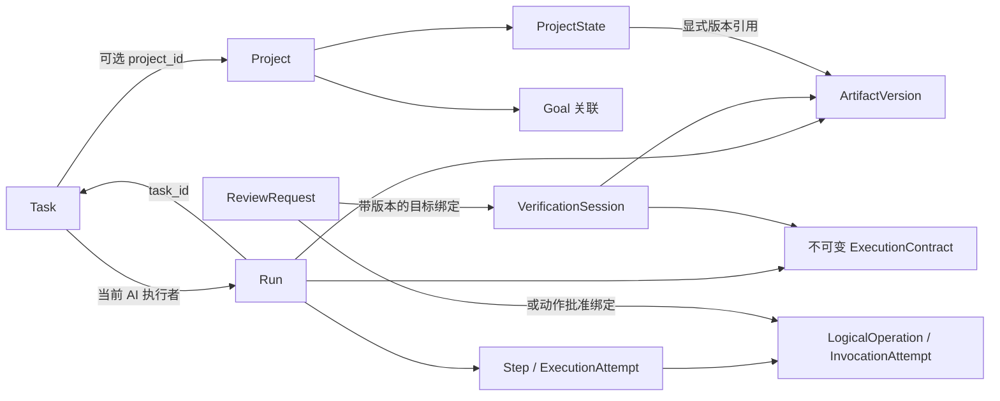

# 领域模型与模块责任：分册 01

角色：所属专题的唯一正文分册；2026-10-25 按原章节迁移，不改变原业务规则、日期、状态与证据范围。

[返回专题路由](../domain-model.md) · [文档总入口](../../README.md)

按需读取本分册内的相关小节；跨章节约束沿链接核对，不能把本分册或历史措辞单独当作完整实现/验收结论。正文中的源码与命令路径沿用原有口径。

## 1. 本轮结论与边界

2026-10-05 有界协作设计接续：主子会话仍由 Assist 原入口保存，原主 Run 拥有内部委派，Task 执行权和完成用例不转交给子 Agent。新增责任、持久身份、预算与恢复统一归[运行架构 §2.5](../runtime-context/part-01.md#25-有界子-agent-的委派与会话关联)，取舍归[ADR-017](../../decisions/ADR-017-bounded-multi-agent-conversations.md)。产品规则已确认，工程协议待核定；本轮只补文档。

采用模块化单体、单一业务事务数据库。Project、Task、Run 分开建模，通过 ID 关联；应用用例协调必要的跨聚合短事务。聚合是保护不变量的写入边界，不要求“一次事务只能修改一个聚合”，也不要求一个逻辑模块对应一个服务或构建工程。

Windows 桌面宿主与本机服务边界见 [ADR-007](../../decisions/ADR-007-windows-desktop.md)：壳管理窗口、启动和生命周期，领域命令仍经已鉴权 HTTP 进入应用用例；renderer 和壳均不成为第二业务 Owner。

本轮确定对象归属、命令责任、事务参与者与持久化约束；不选择数据库产品、不生成 DDL、不发布 HTTP API。重要取舍见 [ADR-001](../../decisions/ADR-001-domain-boundaries.md)。状态枚举及迁移以契约 02 为唯一事实源，本文不复制状态机。

## 2. 领域对象与聚合

下表中的 Owner 指唯一逻辑写入者；读模型可以跨模块查询，不能借查询接口写入。聚合加载仅获取本次判断所需的数据，不加载全部项目、产物历史或执行日志。

| 边界 / Owner | 聚合根与内部对象 | 主要不变量 |
|---|---|---|
| Project | Project；独立 ProjectState 聚合 | 项目属性与 State 分别管理；State 使用独立 revision；不得保存第二份 Task 状态 |
| Goal | Goal | 目标定义独立；Project 拥有其 Goal 关联；Task 拥有显式对齐子集 |
| Task | Task；AcceptanceCriterion、ExecutorAssignment | 状态、验收版本、执行权在同一写入边界；同时最多一个 AI Run 占有执行权 |
| Workflow | Run；Step、ExecutionAttempt、ControlRequest | Run 有独立生命周期；步骤推进校验执行权、worker claim 和控制请求；终态不复活 |
| Artifact | Artifact；ArtifactVersion | 稳定逻辑产物 ID 与不可变版本 ID 分开；版本记录指向已持久保存且校验过的内容 |
| Verification | VerificationSession；CheckResult、EvidenceBinding | 绑定确定的验收契约与产物版本；已记录结果不原地改写，补验留下新证据 |
| Review | ReviewRequest；ReviewDecision | 决策绑定确切对象/内容；接受决定与执行其业务效果分别记录 |
| Permission | PermissionPolicy | 策略版本可追溯；实际调用前检查当前权限，历史批准不能覆盖当前拒绝 |
| Gateway | LogicalOperation；InvocationAttempt | 一次逻辑意图与实际调用次数分开；未知副作用不得通过新 ID 规避 |
| Resource Coordination | ManagedResource；ResourceClaim | 归一化资源独占；过期不等于安全释放；支持隔离、核对后再授权 |
| Information | Knowledge、Memory、Decision、Rule，各自有 ID 和版本 | 语义与生命周期独立；不使用一个任意类型 JSON 对象代替约束 |
| Personal Planning | 用户的 TaskSelection（Pin / Later）、FocusSelection | 用户选择持久化；Today 排序是投影；Pin 不改变 Task 可执行性 |
| Workbench | ViewConfiguration | 仅管理展示；执行配置使用单独的版本化定义，不由切换视图修改 |

Workspace 在 V1 是作用域标识与配置边界，不引入团队成员、租户隔离或权限继承树。ExecutionConfiguration、WorkflowDefinition 由 Workflow 模块管理其版本化定义；Run 固定引用对应版本。它们先服务内置流程，不构成通用流程编辑平台。

2026-09-20 补充（Proposed）：[Relay Skill](../relay-skills.md) 是应用组合入口管理的只读版本化能力定义，不新增领域运行系统。Project Owner 保存 ProjectBlueprintProposal，Application 的 ApplyProjectBlueprint 协调现有 Project/Task/Workbench 写入口；Skill 不拥有 State、Permission 或 Run 生命周期。Rules/执行配置的后续建议由各自入口单独接受。取舍见 [ADR-008](../../decisions/ADR-008-declarative-skills.md)。

扩展组合补充：Relay Pack 的只读定义由同一组合入口管理，项目实际配置及来源仍归各领域 Owner；不以包记录取代当前事实。Workflow Recipe 复用 WorkflowDefinition/Version；Context、Verification、Permission 与 Projection 配置分别归既有职责，不新建统一 Profile 写入模块。Proposal 只统一投影与固定命令分发，Eval 是版本回归而非业务完成裁决。具体组合/升级边界见[扩展模型](../relay-skills.md#8-可组合扩展模型)。

ProjectState 是 Project 模块内部的独立写入边界，便于对状态补丁单独进行并发控制；这不允许绕过 Project 的语义校验。Goal 关联移除涉及显式对齐的 Task 时，由应用用例执行影响检查和用户明确选择的原子清理。

2026-10-17 日常后端接续：Goal 标题/说明与归档仅更新 Goal 自身修订，Project 改名仅更新 Project 自身修订，不联动 Task/Run/ProjectState；接口归[基础维护契约](../../api/project-goal-maintenance.md)。Inbox Task 首次归入 Project 由 Application 在同一短事务协调 Task 与 Assist 原 Owner，保留任务 ID、验收定义及会话历史，拒绝在途消息、已有执行/成果历史或尚存依赖的隐式搬迁；会话创建及依赖上游读取用 Task SHARE 锁与归属更新串行化，不能先读旧归属、再等待外键锁后提交旧作用域。精确入口与非目标归[任务归属契约](../../api/task-project-binding.md)，不替代未来通用跨 Project 迁移协议。

Information 是组织相关概念的逻辑边界，不要求实现四套基础设施。可以复用存储技术和版本机制，但 Rule 的强度、Decision 的替代关系以及来源证据必须保留明确语义。

## 3. 关系与事实来源



图中的双向 ID 引用不代表代码依赖成环。Task 只保存被授予执行权的 Run ID，不调用 Workflow；Run 只保存 Task ID 与契约快照，不调用 Task Repository。

- Project 与 Task 均通过引用关联 Goal。默认继承在读取时计算；只有显式 Task 对齐才存储子集。
- Task 可以没有 Project；Delegate 必须绑定唯一 Project。人工完成不创建虚假的 Run。
- Task 持有当前执行者和 ownership_epoch，是业务执行权事实源。Run 的历史绑定不是当前授权。
- ProjectState 保存人工选择与确认过的事实引用。in_progress 等派生字段由投影计算，不能变成可独立修改的状态副本。
- ArtifactVersion 保存内容位置、摘要、创建来源与时间；“最新版本”“当前选用版本”“验证通过版本”是三个不同问题，不共用一个隐式指针。
- ReviewRequest 的目标使用受约束的类型与绑定字段；不是任意实体 ID，也不是任意 JSON patch。动作批准可以先绑定预留的 operation_id，批准并准入后才创建 PREPARED 调用记录。
- CompletionRecord 是不可变完成凭据，由应用完成用例创建，引用 Task、验收版本、可选 Run、依据与 State 变更结果。Task 模块维护当前完成凭据引用；历史凭据不能重新驱动已重开的 Task。

## 4. 版本、身份与快照

| 字段 / 对象 | 含义与变更时机 | 不应混同 |
|---|---|---|
| entity revision | 可变聚合每次有效更新递增，用于 CAS | 不是验收条件版本 |
| acceptance_revision | 结果定义、必需验收条件实质变更或重开时递增 | 改标题排版不必递增；不能靠旧 PASS 完成新周期 |
| ownership_epoch | 授予、释放或转移业务执行权递增 | 不等同于 worker 重启次数 |
| worker claim epoch / lease | 同一 Run 的具体工作进程认领及存活声明 | 不授予 Task 或资源业务所有权 |
| resource claim token | 对归一化资源的写入准入凭据 | 租约超时不能证明旧外部调用停止 |
| command_id + payload_hash | 一次应用命令的幂等身份 | 相同 ID 不同请求内容必须拒绝 |
| run_id / retry_of | 一次 Run；人工重试新建 Run 并记录来源 | 不重开旧终态 Run |
| step_id / execution_attempt_id | 流程步骤及其执行尝试；修正或重做留下新尝试 | 不等于外部调用次数 |
| operation_id / invocation_id | 稳定外部动作意图及实际调用记录 | 重试调用不能伪造新业务意图 |
| artifact_version_id + content_hash | 不可变内容身份与完整性 | 文件名或逻辑 Artifact ID 不足以绑定验证 |
| review_id / decision_id | 待处理请求及不可变人工决定 | 决定记录不等于业务效果已成功应用 |

V1 以 acceptance_revision 区分重开后的验收周期，不再增加语义重叠的 cycle_number。完成唯一身份为 Task + acceptance_revision + 执行主体（Run 或人工），并另外保证同一 Task 验收周期最多一个有效完成凭据；命令幂等键只处理请求重放，不代替业务唯一约束。

ExecutionContract 在 Run 创建时冻结验收内容、Workflow / 执行配置版本、相关硬规则、关键输入绑定。每次 Context 构建另存 ContextManifest，包含实际采用的内容片段、来源版本/摘要、范围及构建器版本。恢复时可以生成新 Manifest，不覆盖旧快照；也不能借重新构建偷偷替换 Run 的验收契约。

当前权限和适用硬规则仍在动作/完成前重新核查。契约关键内容变化按契约 03 暂停或安全停止旧 Run，重新 Delegate；快照是历史依据，不是永久授权。

## 5. 模块依赖与端口

```text
UI / API / 定时唤醒
        ↓
Application：Delegate、Advance、ResolveReview、Control、Complete、Recover
        ↓
Project | Task | Workflow | Artifact | Verification | Review
Permission | Gateway | Resource Coordination | Information | Personal Planning
        ↓
各模块声明的 Repository / Storage / Checker / Model / Tool 端口
        ↑
基础设施适配器实现端口；组合入口注入依赖
```

跨模块写入只经应用用例与各模块公开写入口。模块不注入其他模块的 Repository，也不发布事件要求其他模块“最终补齐”必须原子的事实。模块可以返回类型化判断结果，由应用协调下一步。

建议首版只有一个应用构建单元，在内部按以上职责组织包。纯领域规则不依赖控制器、具体数据库、模型 SDK 或文件操作 API。数据库事务由应用用例包围，同一数据源的模块 Repository 必须参与同一事务，不各自提前提交。

以上为业务层组织建议，不要求所有技术机制自研。按[复用策略](../复用策略.md)验证现成执行库或同机 harness；采用额外执行进程时，领域事实仍由本应用写入，执行事件与内部 checkpoint 另有明确归属，不把跨进程调用宣称为共享事务。

三个容易成环的关系这样处理：

1. Workflow 返回下一步执行要求；应用层调用 Runtime，Runtime 返回结果；应用层再次调用 Workflow 推进。Runtime 不直接更改 Task 或 Run。
2. Permission 返回 ALLOW / ASK / DENY；应用层在 ASK 时创建 Review 并让 Workflow 等待。Gateway 不调用 Review，Review 也不反向启动 Gateway。
3. Verification 返回结果及依据；应用层决定继续修正、创建 Review 或请求完成。Verification 不直接将 Task 改为 DONE。

Context Builder 与 Workbench Query 均为只读组装器。可以使用专用跨表查询提高效率，但返回投影与依赖版本，不向调用者泄漏可写 ORM 实体。只有显式应用命令能改变事实。

## 6. 应用命令与事务边界

以下是用例名，不是已发布 API。所有写命令先执行幂等检查、作用域校验和必要的 revision 检查；成功结果、关键审计与业务变更同事务保存。

| 命令 | 同一短事务的参与者 | 事务外工作 / 失败处理 |
|---|---|---|
| DelegateTask | Task 执行权 + Run/契约快照 + 命令结果 | 不在事务内调用模型；竞争失败不遗留可运行的孤立 Run |
| PatchProjectState | ProjectState + 命令结果 | 只接受类型化变更；AI 提案需明确接受，可由绑定确切对象/内容/基线的原用户命令表达（见 §12.5），不要求统一额外点击 |
| ApplyProjectBlueprint | Project/Goal 关联、State、新 Task、ViewConfiguration + 提案终态、来源关联、回执/审计 | 只处理经确认的类型化本地变化；重查全部基线；Rules/执行配置另行确认；预览和模型调用在事务外 |
| ChangeAcceptance | Task 新验收版本 + 活动 Run 的持久控制意图 | 安全停止异步完成；新 Run 需显式 Delegate，不能立即抢占 |
| RequestRunControl | Run 的 ControlRequest + 命令结果 | 后台到安全点再 Apply；请求成功不等于已暂停/接手 |
| ApplySafeControl | Run + Task（如发生转移）+ 可安全释放的资源 claim | 前置完成在途核对；无法证明安全则不转移写入权 |
| ResolveReview | Review 决策 + 对应领域效果 + Run 等待状态（需要时） | 标准 V1 决定和 DB 效果同事务；外部动作随后走独立准入 |
| PrepareInvocation | Gateway 意图/调用 + Review 批准占用 + 必要准入记录 | ASK 时只保存 Review，不伪造已获准调用 |
| AdmitInvocation | Gateway CAS 至 DISPATCHING + 最新控制/执行权/权限/资源检查 | 提交后才调用外部系统；调用与结果保存之间可能崩溃 |
| RecordInvocationOutcome | Gateway 结果及证据 | 过期 Worker 只能提交匹配 invocation 的核对证据，不能推进 Run |
| AdvanceStep | Workflow 步骤/尝试 + 本次结果关联 | 要求正确 epoch；相同成功调用只推进一次 |
| RegisterArtifactVersion | Artifact 元数据 + 来源关联 | 内容先保存并验证完整性；事务失败留下可清理孤儿，不假装文件回滚 |
| RecordCheckResult | Verification 结果与证据 | Checker 运行在事务外；结果必须匹配 session 与版本绑定 |
| CompleteTask | Task + 可选 Run + 确定性 State delta + CompletionRecord + 关键审计 | 重核有效性、控制与未决副作用；失败只回滚 DB |
| ReopenTask | Task 新验收周期 + 当前完成投影必要更新 | 保留历史 CompletionRecord/验证；旧重放只返回旧结果 |
| UnlinkProjectGoal | Project 关联 + 经明确选择清理的 Task 显式关联 | 先展示影响；无明确清理选择时拒绝破坏子集约束 |

人工完成同样使用 CompleteTask，但依据为明确的人工接受，执行主体为 HUMAN，不伪造自动 Verification PASS。存在 AI 执行权时不能绕过安全交接直接人工完成。

ResolveReview 通过请求类型映射到固定应用用例，禁止通用“执行任意回调”。重复提交同一决定返回原结果；目标过期则返回冲突，不能将未生效决定显示为已应用。对已批准的外部动作，“决定已应用”只表示准入前提满足，真正执行结果仍以 Gateway 为准。

## 7. 并发与恢复所需的持久化约束

数据库选型必须能够实现以下语义；具体索引、锁语法与隔离级别在数据库设计阶段定稿。

- Task 当前执行者只能为 HUMAN 或一个 Run；Delegate 原子检查并写入，不能采用“先查询无 Run，再无条件插入”。
- 所有 Worker 推进命令同时校验 Task ownership_epoch、Run claim epoch 及有效控制请求；可变事实使用 revision 或锁保护。
- 完成提交与控制请求在同一 Run/Task 序列化边界竞争；建议涉及多个对象时统一按 Task → Run → ProjectState → Resource 的顺序取锁，同类多对象按 ID 排序。实际锁集合由用例决定，不无谓锁整项目。
- 动作准入与控制提交共享 Run 的串行化边界。控制先提交则禁止新准入；准入先提交则该调用按在途处理，不能声称已立即停止。
- command_id 在其作用域内唯一，保存规范化请求摘要与结果；operation_id、invocation_id、ArtifactVersion ID 全局唯一。
- 每个 Step 的推进记录必须标识消费的结果；重复结果不能触发第二次推进。修正循环使用新 ExecutionAttempt，不覆盖旧记录。
- 同一资源的互斥准入由持久化 claim 保证；父子路径、别名无法可靠归一化时拒绝作为独立并发写资源登记。
- DISPATCHING 无可靠结果转入 UNKNOWN 核对；即使租约过期，也保留资源隔离和动作关联。恢复器不得直接将其改成“失败可重试”。
- 验证结果、批准及完成凭据保存精确引用；删除或保留策略不能静默破坏历史证据，缺失明确标注不可用。
- Run 保存当前恢复位置、等待原因、resume_phase、修正预算和待处理控制请求；恢复以已提交事实判断，不靠最后一条日志文本。
- UI 通知不是命令执行证据。提交后丢失通知时，用户刷新可得到同一真实状态；当前方案不要求消息代理或事件溯源。

这些约束需要真实数据库集成与故障注入验证。仅单元测试、进程内锁或 UI 禁用按钮均不足以证明成立。

维护排空使用数据库级持久准入门，位于首次业务命令及新领取的业务锁之前；维护变更与原命令回执同事务，旧回执和停止控制保留。该门不改 Task/Run 的执行权，DRAINING 仍允许原在途结算和图写入，不能证明可备份的静止快照。取舍与范围见 [ADR-014](../../decisions/ADR-014-database-maintenance-admission.md)，运行说明见[部署设计](../../deployment/本机部署.md#4-备份恢复)。

Windows 原宿主停机由同一桌面 EXE 的私有维护入口复用原 ARMED/Job Owner，并持当前登录会话的旧单实例 guard；Node 只持活的私有协议会话，不导入任意停机证明。它不承担业务恢复或数据库状态写入，失锁不能继续作为维护授权。独立写者、内容发布和 Saver 的安全点仍是备份协调职责；见[M07 边界记录](../../development/m07-backup-recovery.md)。

Windows 受管内容的物理发布由既有原生文件助手持共享锁并执行完整 IO，维护排他与实际写者互斥；ManagedContentStore 仍是应用的存储入口，版本/事务 Owner 不变。缺助手不回退 Node IO，公开错误沿既有存储错误契约。该锁不覆盖外部工具或 PG/Saver，取舍与兼容见 [ADR-015](../../decisions/ADR-015-managed-content-native-publication.md)。

数据库连接维护由受信运维CLI的独立migrator会话持原DDL锁，修改前保留原ACL凭据，并拒绝未知旧连接、启动连接及prepared事务。它只操作数据库权限元数据、只读DRAINING，不写Task/Run或替代Application的业务Owner；恢复原权限不自动恢复执行。完整备份协调仍需结合存活停机/内容会话及原效果核对；取舍见 [ADR-014](../../decisions/ADR-014-database-maintenance-admission.md#2026-10-01-接续决定独立数据库连接维护会话)。

## 8. 首条纵向路径

选择“围绕项目资料形成一份有来源的 Markdown 研究摘要”作为设计贯通示例，不额外承诺新产品范围。

1. 用户建立 Project 和 Task，写明目标、资料范围、必需结果与人工/自动验收项。
2. Delegate 原子冻结契约并分配执行权；固定 Workflow 构建有版本依据的 Context。
3. Fake Worker 先生成受管 Markdown；内容保存成功后登记 ArtifactVersion。
4. Checker 验证格式、必需引用与适用规则；语义不确定或指定人工项进入 Review。
5. 人工判断仅影响绑定版本。需要编辑时先 Handoff；修改形成新版本后重新验证。
6. 完成用例核对全部前提，再原子提交 Task、Run、确定性 State 引用与凭据。
7. 故障测试在动作准入、结果保存、验证保存、完成提交前后中断；恢复不能重复副作用，也不能重复完成。

## 9. 与现有验收规格对照

| 设计责任 | 现有规格 | 本轮补充的检查点 |
|---|---|---|
| Project / Task / State | A01–A03、A08–A09 | State 独立 revision；Goal 移除与 Task 子集原子一致 |
| 规则与双视图 | A04–A07、C08 | 只读投影不持有写模型；Context 保留实际输入版本 |
| 生命周期与执行权 | B01–B08 | Task epoch 与 worker claim 分离；安全控制才移交 |
| 验收与人工判断 | C01–C09 | Review 决定、DB 效果、外部执行三者可区分 |
| 恢复与提交 | D01–D11 | 模块 Repository 同事务；准入/控制串行化；重开后的完成唯一约束 |

以上为设计审查映射，不增加一套重复编号，不表示 37 项测试已通过。

## 10. 下一步及待确认项

已进一步形成[数据库逻辑模型](../../database/logical-model.md)、[技术选型](../技术选型.md)、[PostgreSQL 物理设计](../../database/physical-design-postgresql.md)、[API 契约](../../api/http-command-contract.md)与[首条工程切片](../../development/first-human-slice.md)。物理层补充 Authority → Task → Run → ProjectState → Resource 的锁序，以及批准占用和调用绑定拆分。当前阶段与下一任务统一见 [CODEX_NEXT_STEP](../../../CODEX_NEXT_STEP.md)，不在本文另排进度。

仍待确认：原件对照中的待确认细化、依赖精确补丁和组合验证、内容存储的目标平台保证与保留策略、具体 Workflow/Checker 的首版集合。数据库方面用户已确认允许本机 PostgreSQL，技术细节以选型草案为准。

本轮未更改四份契约的产品语义、状态枚举或安全范围；新增的是实现责任分配与并发落点。未改动 Manga 项目，未建立运行时代码。

## 11. V1 后续协作的架构演进提案

2026-09-28，Proposed；本节仅定义[后续路线](../../requirements/post-v1-roadmap.md)的责任与一致性边界，不宣称已有实现。方案比较和理由归 [ADR-013](../../decisions/ADR-013-bounded-project-continuation.md)，详细命令/字段在各片开工前进入 API/数据库主文档。

### 11.1 对象与唯一责任

| 增量 | 逻辑 Owner | 只允许保存的新增事实/引用 |
|---|---|---|
| 项目接续点 | Project | 接续点身份、说明及一致的版本引用集合；不复制 Task/Run 当前状态 |
| 跨成果候选组 | 原 Proposal/Assist 用例协调，Artifact 拥有版本与锁 | 候选关联、源/目标基线及逐项处理回执；不成为第二 Artifact 库 |
| 组合检查单 | Application 协调，Verification 仍拥有单项结论 | 被一起审阅的确切版本集合与当时看到的单项验证事实；不产生整体 PASS |
| 知识导读/组织 | Information | 有范围的编排与 Knowledge/Artifact 等引用；Context/搜索仍为只读投影 |
| 知识整理候选 | Information | 来源成果版本与建议归类、相似提示；接受仍由既有知识命令执行 |
| 周期计划 | Personal Planning，应用用例提交 Task/Goal 变化 | 计划候选及处理来源；实际 Task 状态仍归 Task |
| 有限触发 | Personal Planning 拥有触发配置，Infrastructure 负责时钟/唤醒 | 配置版本、触发发生身份、领取/命令关联和处置；不授予执行权 |
| 有限连续委托 | Application 协调项目执行授权，Workflow 仍拥有各 Run | 用户授予的范围/预算、撤销与原 Task/Run/command 关联；不另造任务完成状态机 |
| Skill/Profile 配置 | 既有声明注册与配置入口 | 固定版本、允许引用及 Eval 证据；不载入可执行代码 |

这是逻辑分工，不是一项一个服务、表或包。队列/计划中的“完成”只能是原 Task/CompletionRecord 的投影；若确需调度领取状态，必须与业务状态明确区分。

2026-10-02 N02 首片已实现的两个对象：候选组由 `CreateImpactCandidateGroup` 在同一事务内写入组与有序目标项，**不调用模型、不推进 revision、不授予执行权**；逐项应用继续调用既有 `ApplyArtifactImpactCandidate`，组只旁读该命令的回执，因此部分成功是投影事实而不是第二套提交协议。组合检查单由 `CreateArtifactCombinationCheck` 捕获确切版本集合与当时的单项验证事实，`overall_result` 恒为 `NONE`——整体不可判是类型语义，不存常量列也不新增 Verification 会话。两者都只追加引用，不复制成果正文。

### 11.2 用例与事务

检查点捕获在数据库一致性快照内读取对象及版本引用；内容文件复用既有不可变存储和 hash。引用集合需要保留/删除约束，不能在保存后被清理策略悄悄破坏。AI 导读生成在事务外，绑定捕获基准；当前权限改变后仍须遮蔽历史受限来源。

候选组默认逐项调用既有命令，保存每项回执和部分成功；没有共同事务协议时不显示整组原子完成。跨成果组合验收绑定确切版本集合及验收/检查基准，任何依赖变化使相关结果失效，不修改历史成绩。

2026-10-02 落实：候选组不新增写路径，逐项应用仍由既有命令的 CAS 与锁定栅栏裁决，组读把每项 `applied_version_id` 与失效原因并列展示。组合检查单在同一短事务内读取每个确切版本的正文摘要、当前性、所属 Task 的当前验收修订与该修订下的验证会话，把缺口写成可计算事实；所选版本跨 Task 时拒绝，因为 Verification 会话本身按 Task+验收修订划分。

触发记录与投递请求按稳定身份幂等持久化，唤醒丢失由扫描补偿。2026-10-02 已确认的 N05 首片只持久化一次性「继续项目」提醒/待处理，定时触发不调用模型；用户点击后主动发起的计划请求及模型调用另外绑定原身份，不以重复调度重付模型成本。定时器不推进 LangGraph、不写 Task。时间/时区、时钟变化与排队协议仍须在 N05 实施前冻结。

二轮确认：N04 的容量是本段计划窗口，预计执行/等待/审阅与人工投入分别表达，不自动授予执行权或设定 N06 授权有效期；关键估时未知先形成有界诊断候选，完成诊断不等于完成原修复 Task。N05 保存用户确认的同一实际提醒时刻及原设置时区；显示/设备时区变化不能写提醒配置或变更发生身份，显式时间编辑与触发须按版本串行裁决，原待处理事实保留。物理字段与具体接口在实施前核定。

2026-10-18 N08 定时启动：`ScheduledTask` 归 Personal Planning，只拥有任务模板、重复规则、下次触发时刻、授权参数与触发发生记录；**不拥有 Task 状态、Run 生命周期、验收或执行权**。每次触发新建一个 Task（Task 终态不可复活，故周期只能表现为「每次新建」），再经原 `CreateTask` / `MarkTaskReady` / `DelegateTask` 准入。触发只按创建时已持久化的显式授权（`max_runs`、`authorization_expires_at` ≤ 90 天）执行，不授予新权限；`delegateTask` 在原命令事务内核对计划状态、代次、有效期、预算预留与上一轮 Task 终态，未通过即拒绝且效果不落库。因此「触发不写 Task」的 N05 口径对**提醒**继续成立，对**定时任务**由本条替代——两者不是同一事实，不能互相借用。准入以 Task 终态而非 Run 活跃为准：Run 完成后 Task 停在 WAITING 等人工验收，此时本轮跳过，不自动代答。错过不自动执行，只形成待处理。取舍与代价见 [ADR-026](../../decisions/ADR-026-scheduled-task-autostart.md)，协议归 HTTP §10.92、数据库 §102。

连续委托在应用用例内原子检查授权有效性、Task revision、资格和预算预留，再调用原 Delegate 与命令入口。不得依赖“先查还有预算、事务外再创建 Run”；跨 Worker 预算需要持久原子预留，单进程计数不算全局限制。用量未知的预留不能静默释放。具体锁顺序需与现有 authority、Task/Run、资源锁核对并以真实 PG 验证。

2026-10-02 已确认的 N06 首片以任务数、模型调用次数和授权有效期限制新准入；用量未知保留预留并阻止后续准入，金额只有可信依据时才展示。一次明确执行请求可覆盖选定任务集合，当前 Task 仍须经原验证、必要人工判断和完成用例后才准入下一项。产品规则确认不代表预算存储、锁序或恢复协议已实现。

### 11.3 版本、停止与恢复

提案接受、触发启用、执行授权、动作批准、业务完成各自有独立含义和确切基线。读取原件、保存知识或打开页面不能自动跨越其中任何一步。

2026-10-09 的自然语言确认与返回核对边界归[§12.5](part-01.md#125-自然语言状态维护的应用边界)：原用户命令可以承载对应业务确认，返回仅触发已获授权的核对；两者均不合并上述职责。日常已查看基线和用户命名接续点分别保留，不新增第二套 Project State。

撤销授权先持久化并阻止新的准入，再对已运行任务请求原控制；停止请求不是停机证明。Delegate 回执丢失按原 command 查回执，不换 Task/Run 或授权身份重新执行。原调用 UNKNOWN 保留动作/资源隔离，不因用户改计划、停触发或更换执行器释放。

二轮确认 N06 到期行为：Application 核验原授权基线后阻止新准入，并复用原持久 PAUSE 控制请求当前任务在安全点暂停，Workflow 仍负责实际应用。暂停意图持久化到控制应用之间的崩溃必须可恢复；续期/到期与暂停/完成竞争按原身份和基线裁决，已完成事实不改回暂停，旧到期请求不能影响后来独立获授权的执行。“暂停中”不等于“已暂停”，未决外部效果和 UNKNOWN 仍先核对；N04 计划窗口不自动触发此控制。具体授权版本、原子协调及补偿协议尚待实施前核定。

首片关闭桌面即停止新调度，不安装后台服务、不宣称关闭应用仍运行。2026-10-02 用户确认：N05 重开后对错过的有效提醒最多补同一条待处理，不自动生成计划/补跑模型；N06 重启后先恢复和核对原持久事实，待用户明确继续才准入下一项，保留原任务/动作身份和累计预算。旧授权有效也不自动开始下一项；正在核对的 UNKNOWN 不因继续意图重发。需要退出后运行时另行设计宿主与部署边界。

### 11.4 接口和演进边界

现有 UI/API/Application/Domain/Repository/Infrastructure 依赖方向保持。新增接口采用专用命令和带版本的只读 DTO，沿用幂等/错误/权限协议，不增加通用 JSON Patch、任意工具转发或直写接口。API、物理 schema、OpenAPI、迁移与兼容策略在每包实现前冻结；本轮没有发布 API 或数据库变更。

React、Tauri、Node、Fastify、Kysely/PostgreSQL 与 LangGraph 的技术职责不变。性能瓶颈先测排队、首内容、持久化和渲染，必要时做局部优化；新解析器、索引或外部执行器按证据单独选型，不凭后续路线一次安装全部候选依赖。

2026-10-02 N03 首片落实两点边界。其一，导读编排是**替换式保存**而非追加：编辑一份导读就是提交整份清单并按 `revision` CAS，因为它是人工编排的导航而不是需要留痕的事件流；条目因此可删除，但它们指向的知识版本、决定、规则与成果版本仍按原契约不可变。其二，整理候选**不是独立命令**：它复用既有 `CreateKnowledge` / `AddKnowledgeVersion` 的幂等与事务（命令不可嵌套，外层再包一层会在同一行上互锁），接受后再按候选自身状态绑定结果。这带来一个已知例外——接受端点没有独立的 `command_type` 回执条目，幂等身份就是内层知识命令的原 `command_id`。相似判定当前只按标题字面，前缀阈值是启发式而非相似度结论；**候选永不自动合并或删除既有内容，也不得顺带升级 Rule 或 Decision**。

## 12. 文件夹入口与对话执行的应用边界

2026-10-01。产品规则及复用 Owner 原则见[ADR-016](../../decisions/ADR-016-folder-first-conversation.md)，完整交互只在[工作台 §18](../../frontend/workbench-design/part-04.md#18-文件夹入口与对话直接执行)维护。用户已确认直接执行入口；具体 API/schema/锁顺序待工程核定，本轮只有文档和提示词，不能把本节视为当前实现。

### 12.1 对象与责任

原闭环继续成立：`Goal / Project State → Task → Human / AI Execution → Artifact → Verification / Human Acceptance → Business Commit → Updated Project State`。对话提供该闭环的输入与接续视图，不拥有 Goal/Task/State 的第二份事实。Task 的 Goal 关联继续由原 Owner 按继承与显式对齐规则处理；目录绑定及会话创建不重置 Goal/State，不自动创立目标或完成凭据。

| 对象/责任 | 边界 |
|---|---|
| Workspace | 沿用数据库作用域与配置边界，文件夹不是新租户/数据库 Workspace |
| Project 与 ManagedResource | Application 协调找到或建立最小关联；Project Owner 管理项目，Resource Coordination 管理目录身份及冲突 |
| Assist 会话/消息 | 可先不绑定 Task；保存原用户请求与有版本的来源，关联实际执行任务；不能拥有项目自主写权。会话可被软归档（有反向命令、可撤销），也可由用户显式物理删除（不可撤销、无恢复语义，[ADR-027](../../decisions/ADR-027-session-physical-delete.md)）；删除只覆盖会话自有账本，被其它对象引用时拒绝 |
| 请求解释与执行准备 | Application 组合入口复用现有 Assist/模型端口整理候选；保存原消息身份、内容基准、范围及命令来源，由确定性规则验证后分发固定领域命令 |
| Task / Workflow | 原 Owner 创建任务、冻结执行契约、Delegate、推进 Run、控制及恢复；不新增聊天专属执行权/第二状态机 |
| Permission / Gateway | 每次动作准入核对当前权限、资源和审批；明确用户请求不替代具体动作批准 |
| Context / Artifact / Verification / Review | 目录输入可追溯，产物版本不可变；验证与完成仍绑定确切任务、版本和验收要求 |

CreateAssistSession 当前源码允许 projectId/taskId 为空，这只是可复用的创建基础。当前 Task 级会话的 task_id 在创建时固定，候选产物提案依赖它；项目级多任务对话应核定稳定的消息→执行请求→Task/Run 关联，不覆盖旧会话目标。现有 USER 消息的 intent 为 DISCUSS，也不能直接当作已获授权的执行字段。无任务会话的 Context、消息恢复、工具读取和多任务来源关系必须按实际实现核定。

### 12.2 用例与事务

目录打开用例接收宿主提供的选中路径，服务端核对存在性、规范路径、实际资源身份和可访问 Project。稳定关联持久化在原业务数据库；近期排序/布局可为展示偏好，但不能作为资源身份或授权事实。同一作用域重复/并发打开应复用已确定关联；多项目歧义需显式选择。跨作用域不泄露其他项目关联。

大小写、路径别名、目录链接、搬迁、同路径替换及嵌套根按 Windows 文件身份/受管资源协议核对；不能只用字符串去重。不能为每个 Project 生成互不冲突的资源 ID，从而让同一物理目录出现两个写 Owner。既有目录在其他业务中处于 UNKNOWN/隔离或停用时不借重新打开恢复写准入。具体关联唯一键、重叠根及旧数据处理在物理设计/migration 中冻结，不提前写出未经验证的约束。

当前源码边界：登记入口只拒绝同 Project 的相同活动 identity_key，跨 Project/父子根的排他检查在动作准入路径另行进行，不能声称登记已经统一拒绝重叠。目录打开用例需先解析已有绑定及歧义，写准入继续核查实际重叠资源。file_write_root_id 可能为空，能打开或登记目录不等于 Windows 写身份已绑定。

原用户消息持久化后，解释和模型整理在事务外执行；候选结果须先保留，后续故障恢复不无故重跑模型。执行准入在短事务内校验原请求授权范围、当前绑定/权限、任务版本、依赖与必要字段，保存来源及原命令，调用原 Task/Delegate 入口。仅省去重复点击，不能跳过 READY、ownership_epoch、资源排他和审批检查。现有入口若无法共享同一事务，必须持久保存各阶段回执和可恢复进度，不把多个 HTTP 请求伪装成原子操作。

首条发送串起会话创建与消息发送；目录关联、解释保存、任务准备、Delegate 分别有稳定幂等身份并关联一次用户意图。结果未明时查原回执；一次已启动的请求不能因换页面、新会话、同文重试或模型重复结果而创建第二 Task/Run。用户后来有意发出的新请求使用新意图身份，不用文本相同与否代替幂等判断。确切字段/键和唯一约束在实施时设计并以真实 PG 验证。

纯讨论没有 Task/Run 写执行。需要项目工具执行时必须落到唯一 Project 和受管目录。执行来源是用户明确请求及有效约束，模型只做解释，不能用输出或网页/文件内容替代授权；请求整理不扩张为通用 Planner、意图 DSL 或自主循环。活跃 Run 的新范围按原安全停止/重新委托路径处理，未处理在途动作前不授予冲突执行权。

#### 12.2.1 本地目录访问设置的应用责任（2026-10-18，已实施）

产品规则唯一归[工作台 §18.1.4](../../frontend/workbench-design/part-05.md#1814-本地目录权限设置2026-10-18已确认已实施)。主动选目录表达对该根基础读取的授权，写档位表达本目录的写准入方式；Application 协调原受管资源、连接/策略 Owner 与命令回执，不由 UI、模型或 Adapter 直接写配置。权限仍只有原 Gateway 一套准入事实，不新增独立的“目录允许列表”作为旁路。

目录身份/物理检查放在短事务之外，提交时重查权威版本与根身份；目录关联、应用管理配置及设置回执须一致保存。优先复用现有事务内领域/仓储能力；若原命令只能分阶段提交，就保留固定阶段身份、已提交结果和可恢复状态，不能把多个 HTTP/磁盘动作说成原子。并发选择与改档按 workspace/project/resource 的既有锁序和 revision 收敛到一份有效结果，确需 schema 约束时再关联追加 migration。

应用需识别本入口管理的条目及撤销/停用历史，避免补默认配置时绕过用户限制。就绪投影、会话读取连接选择、Run 信封准备和 Gateway 都按当前目录真实边界匹配，不能任取同项目的首个能力连接。旧手工设置与在途 Run/Operation/Review 不迁移执行身份；已有 Run 的配置/策略变更继续按原版本复查和安全停止/UNKNOWN 规则处理。GET、恢复旧会话或模型输出不触发权限重建，读权限设置也不发起模型调用。

**当前实现**：`OpenWorkingDirectory` 在用户主动成功打开目录时调用 `ensureLocalDirectoryReadAccess`，为该根建立或复用默认只读的本地访问记录及基础文件读取配置；没有活动匹配项时，还按 Workspace/Project/能力/动作与根覆盖范围读取既有策略版本历史，避免默认 AUTO 重建已撤销的读取范围。后续明确活动授权可复用，不相关目录不受历史记录阻止；查询和恢复旧会话不触发配置写入。`SetLocalDirectoryWriteTier` 通过 `setLocalDirectoryWriteTier` 按 `expected_revision` 更新档位，并记录由本入口管理的连接/策略身份。命令在首次执行前核对真实根；已有回执的重放仍校验命令作用域和完整载荷，但不再依赖当前磁盘根。迁移 `0109_local_directory_access.sql` 保存这些管理元数据，不创建第二套准入事实；迁移 `0112_local_directory_full_access.sql` 只放宽该表的档位 CHECK 以加入 `FULL`（物理边界见[物理设计 §101](../../database/physical-design-postgresql/part-05.md#101-0112-本地目录完全访问档位2026-10-18-源码实现)）。`FULL` 不引入第四种 Gateway 判定——它与 `AUTO` 落同一条策略行，差别只在档位这一列，因此实际准入必须按资源回读该列，prepare 与 dispatch 各读一次同一个函数；这一列仍不是准入事实本身，显式 DENY、上层受管根与目录根边界都优先于它。就绪投影、会话读取连接选择、Run 信封准备和 Gateway 均按当前目录根匹配，显式拒绝、停用、上层限制和 UNKNOWN 仍由原 Gateway/Run 规则约束。API 与物理结构见[HTTP 契约 §10.86](../../api/http-command-contract/part-06.md#1086-目录写入档位投影与只读查询2026-10-17-源码实现)及[物理设计 §98](../../database/physical-design-postgresql/part-04.md#98-0109-本地目录访问档位元数据2026-10-18-源码实现)。2026-10-20 接续：同一个 `ensureLocalDirectoryReadAccess` 还负责 Git 只读——被打开的目录**就是** Git 仓库根时，在同一事务里建立 `GIT_READ` 连接与 status/diff/log 三条 AUTO 策略，并把连接指针写进 `local_directory_access.git_connection_id`（迁移 0124）；子目录不授权（`git log` 的输出不受子目录限制），停用/撤销/历史规则只报告不自动恢复，`GIT_WRITE` 不在其中。`GIT_READ` 的工具发现改为精确根匹配，文件能力仍按前缀，避免父目录连接覆盖子目录资源。协议见 [HTTP §10.103](../../api/http-command-contract/part-07.md#10103-目录打开结果中的-git-只读投影2026-10-20-源码实现迁移-0124)。运行结果和未验边界只记在[统一验收表](../../testing/overall-acceptance-2026-09-28.md#当前功能验收表)。

### 12.3 持久化、恢复与接口

UI 从持久事实恢复准备阶段、原消息/命令/会话/任务/Run 关系及部分成功，不靠内存 Loading 宣布已开始。Worker 过期、控制竞争、UNKNOWN 和完成语义沿契约 02–04，不通过新任务或新目录关联绕过。活动会话与多任务的关联形式、旧会话兼容和原消息约束需在实现前核定；不批量将旧聊天自动转换成任务。

原鉴权 API 和幂等/回执协议继续适用。Tauri 只选择目录及管理宿主生命周期，不直接写 Project/Task/权限；API 查询不产生创建、执行或模型外发。必要新命令、只读 DTO、OpenAPI、迁移与兼容策略分别归 API/数据库主文档，新增 migration 追加且不改历史摘要。本轮 Breaking Change：No（无运行接口变更）；未来按实际变更说明。

工程须先核对现有 Runtime/工具能力，把所需的真实受控动作接入唯一编排与 Gateway，不能仅调用旧 DRAFT 就报告已改文件。保留 TypeScript-first/React/Tauri/Fastify/Kysely/PG/LangGraph 组合，不另建执行器、通用任意 Shell 或绕过业务 Owner 的写路径；能力缺口如实列出并完成本范围必要实现与验证。

### 12.4 当前实现的对象与边界（2026-10-02）

**Breaking Change：No**（新增应用用例、两个 HTTP 命令、一张新表与一个可选委托字段；既有 Task/Run/Review/Assist/Gateway 状态不变）。

| 对象/责任 | 当前落点与边界 |
|---|---|
| 目录关联 | [openWorkingDirectory](../../../apps/api/src/application/open-working-directory.ts) 只组合既有 Project 与 ManagedResource Owner。真实路径、规范身份与 Windows 写身份在事务外采集；关联判定、歧义裁决与最小 Project 建立在一个短事务内（authority → Project → 资源登记 advisory 锁）。已有重叠受管根时**不新开项目**造出第二个写 Owner，改为列出既有作用域等一次显式选择。`write_readiness` 只是只读投影，本用例不创建连接、不放宽权限。 |
| 执行请求 | [conversation-execution.ts](../../../apps/api/src/application/conversation-execution.ts) 与 `conversation_execution_requests`。授权来源永远是 `source_message_id` 指向的那条原用户消息；模型只经 `AssistModelPort.interpret` 输出候选，解析与准入由 `validateConversationCandidate` 的确定性规则判定，再分发既有 `prepareTaskCreation` / `markTaskReady` / `delegateTask`。**不新增聊天专属执行权或第二状态机。** |
| 解释与执行的边界 | 解释与执行是两个命令。模型调用在事务外；候选先落库（`candidate_status` 只能从 `PENDING` 结算一次）；Task 事实与 `TASK_PREPARED` 在同一短事务提交；READY 与 Delegate 各自是既有命令并各自留回执。三个阶段命令身份在请求创建时固定，恢复只重放原回执，因此换页面、重启或双击都不会产生第二个 Task/Run，也不重付已保存的模型整理成本。 |
| 冻结动作链 | `readFrozenRunActions` 统一校验冻结动作集合：一个读取动作，或「Fake 标记 / 文件变更 / 检查命令」其一，或「文件变更 + 检查命令」。`CLI_RUN` 由此成为 Run 内可达的真实受控命令（`shell: false`，非 `approvalPassthrough`，每次仍单独要 `ACTION_APPROVAL`）。`readPendingFrozenRunAction` 只依据持久事实选择下一个未成功落地的动作；全部成功时返回最后一个，供等待审批的恢复交付读回持久结果。 |
| 基线冻结 | 对话候选里的 MODIFY/DELETE 在 Delegate 之前，由应用层在受管根内读取当前字节并计算 `baselineSha256`，路径先经 `canonicalRelativePath` 校验。落盘前 Gateway 仍会重新比对，读取不进入 Delegate 事务。 |

未实现与未验证：真实 Windows 原生目录选择、取消、重启、中文 IME 与 DPI 取证；会话内多任务的完整恢复矩阵（FC-06/09/10）。范围只在[功能验收表](../../testing/overall-acceptance-2026-09-28.md#当前功能验收表)记录。

### 12.5 自然语言状态维护的应用边界

2026-10-09。**产品设计已确认；2026-10-09 晚实施第一批闭环（对话状态维护的解释/应用/整组撤回与日常查看基线），2026-10-10 完成整改与既有对象/决定续答切片，2026-10-10 独立复验后完成 R1–R6 整改与第五节切片（外部成果核对/完成指令、自然语言撤回、返回轻量核对），协议与物理结构见[HTTP 契约 §10.61–§10.64](../../api/http-command-contract.md)与[物理设计 §63–§71](../../database/physical-design-postgresql.md)，Breaking Change：Yes（仅 `daily-view-confirmations`：新增必填 `presentation_seq` 与 2026-10-10 的签发记录逐项核对，其余为新增端点/字段/状态词与追加迁移 0064–0070）。** 产品事实源为[总纲 §0.8.1](../../requirements/product-spec/part-01.md#081-自然语言维护项目状态)，交互归[工作台 §18.9](../../frontend/workbench-design/part-07.md#189-自然语言状态维护与接续摘要)。沿用原 Owner、短事务、版本/执行权、权限及恢复契约，未决定新的技术栈或通用编排器。

- **输入与写入。** Assist 保存原用户消息和来源；模型在事务外解释意图，Application 核对确切目标、类型化变更、用户确认范围及当前基线，再调用各对象原创建/修改/接受入口。对话、UI 和模型均不直接写存储。尚未建立的需求 Owner/写契约另行核定，不把通用入口假定为已有能力；助手模式继续拒绝业务写入。
- **确认与批次。** 明确命令可以替代对应接受点击，但不能为模型新增的目标/内容、另一既定承诺或动作审批提供授权。一般修改/收录命令不能被推断为完成确认；明确的完成或人工接受指令仍须绑定确切产物/条件、满足原完成规则，并由原完成用例提交。一次请求关联实际领域命令及各项回执，保存必要来源与变更前后引用；跨 Owner 未有共同事务协议时如实表达部分成功。摘要只投影原事实，不拥有独立生效状态。
- **适用基线（2026-10-10 实施）。** 解释结算即确认时点：此时把每条变更的适用版本与实际目标身份冻结（迁移 `0064.baseline_ref`），应用与补偿分别重查；版本或身份对不上就保留当前事实并给出类型化冲突（`STATE_VERSION_CONFLICT`/`TARGET_IDENTITY_CONFLICT`/`TARGET_VERSION_CONFLICT`），由用户基于最新状态重新确认。冲突按版本识别，不比较字段值——后续修改可能又改回同值。标题重名、重命名与目标替换因此不会让命令落到另一对象；确认时点尚不存在的对象（同组先创建后引用）在应用时才首次解析。
- **待决定与续答（2026-10-10 实施）。** `decision_required.blocked_changes` 给出等待决定的变更序号，独立且明确的修改照常生效，不被另一项必要决定整组冻结；缺省整组等待。续答沿 `POST .../decision-replies` 提交，绑定原请求与用户看到答案时的 `expected_revision`（不符 409 `DECISION_STALE`），不重算新方案冒充已确认；决定本身不写业务事实，落库后由原 applications 入口继续原请求。
- **外部进展与核对。** 用户报告保存为带来源的信息，Application 在已有作用域/权限内读取成果和证据，Verification/Review/完成用例继续裁决。来源读取、模型、文件和检查均在短事务外；将成果核对为完成须绑定当前对象、产物及验收基准，不能沿用其他工具或旧版本的自报成功。2026-10-10 实施 `SYNC_EXTERNAL_RESULT`（只读核对，结果分类入账并写审计，不完成不接受）与 `COMPLETE_TASK`（沿原完成 Owner 提交，接受声明绑定原消息原文，见[HTTP 契约 §10.64](../../api/http-command-contract/part-04.md#1064-外部成果核对完成指令自然语言撤回与返回轻量核对2026-10-10-源码实现)）；run 侧验证会话的核对复用与错误分支（FAIL/ERROR 会话的对话内呈现）仍按 §24 规格在后续补验。
- **日常查看基线。** Project/Application 责任内维护必要的可追溯版本引用与查看位置，命名接续点仍归原 Project 用例。读取与实际查看确认分开，失败/过期/局部结果不能覆盖有效比较基线；已查看不是业务接受或接手。摘要中的非原子读取和缺口必须明确。捕获集合与查看确认协议已于 2026-10-10 实施（迁移 `0065`）：读取时由服务端按项目签发展示序号，推进要求「序号严格增大且 State revision 不倒退」，任务集合超 200 条按截断标记并把 delta 该维度置为未知；不提前扩展 N01 首片表或存储快照正文。
- **自动检查。** 返回是核对触发，不是新的广泛权限。真实检查复用原 Gateway、可信材料与执行账本，每次重查作用域、权限、配置和预算；未变化也须核对原证据适用性。检查结果保存后由原业务入口处理，返回不会自动恢复 Run、修复或启动新任务。2026-10-10 实施第一层「返回轻量核对」（`POST /projects/{id}/return-reviews`，迁移 `0069`）：权限先行、差异与完成证据适用性按事实指纹持久为 `project_return_reviews` 一行，重复打开复用同记录、事实变化重新核对，同步只读且不伪造 Run。去重、在途归属、资源排他、预算和停止/重启协议的**执行型检查**（FrozenCheck 真实外呼、目录资源与模型预算在返回路径的完整核算）仍须在接入前核定，不能为了核对另外创建伪执行权或长事务。
- **纠正与撤回。** 撤回绑定原请求及其实际生效命令，不使用数据库或全项目快照回滚。Application 先做**只读事前预检**（`GET .../undo-plan`）：逐条判定后续修改、依赖、在途工作与无撤销入口项，附影响；原范围里有任一不可撤回项时一项都不补偿，先给出具体方案并取得用户对**具体范围**的决定（回传 `plan_digest` + `confirmed_change_ids`），确认范围与已确认方案在同一语句里持久（`undo_scope`），CAS 输方不执行计划；预检后事实变化由摘要不匹配拒绝（`UNDO_PLAN_STALE`）。保留历史、原批准失效与验证版本语义。结果未知先核对原命令/动作，不换身份重发；`UNDOING` 已提交的中断按原 `undo_command_id` 重入继续剩余补偿，也不把状态撤回假装为外部副作用已撤销。解释可带同会话上下文以便纠正与续答对上原对象，但上下文只供理解、不构成授权。2026-10-10 起自然语言撤回（`UNDO_STATE_CHANGE`，迁移 `0070`）也走同一用例：候选不带 ID，结算冻结同会话唯一已生效调整，0/多候选类型化失败不猜原对象；撤回结果本身不再被本组撤回自动反撤回。

后续实施须分别冻结原消息→目标/基线/确认→领域命令/变更组关系、日常基线及查看协议、核对授权/预算/停止协议、撤回前置条件和补偿。新增接口与物理结构按所属 API/数据库文档记录兼容与迁移，再以[验收规格 §24](../../testing/verification-plan/part-05.md#24-自然语言状态维护与自动接续验收规格)验证；本节不提升现有完成或验收结论。

