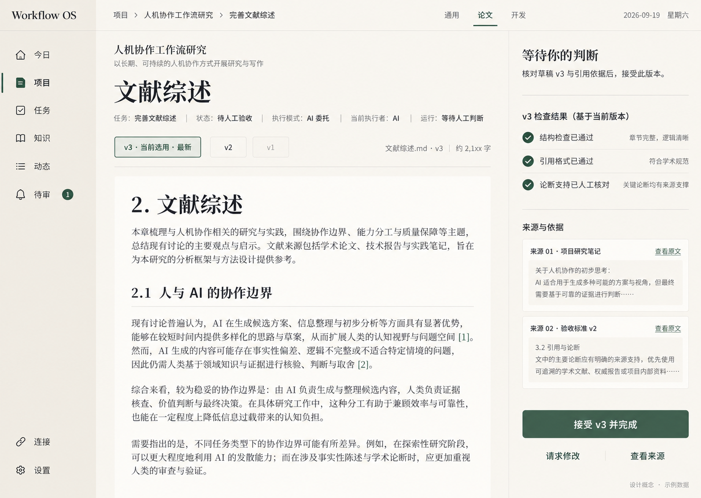

# 视觉与组件规范：分册 01

角色：所属专题的唯一正文分册；2026-10-25 按原章节迁移，不改变原业务规则、日期、状态与证据范围。

[返回专题路由](../design-system.md) · [文档总入口](../../README.md)

按需读取本分册内的相关小节；跨章节约束沿链接核对，不能把本分册或历史措辞单独当作完整实现/验收结论。正文中的源码与命令路径沿用原有口径。

## 1. 视觉依据与提取边界

既有设计图是风格与历史页面依据。以[原始论文验收页](../../../thesis-review-original-20260919.png)为视觉锚点，[今日](../mockups/2026-09-19/today.png)、[项目总览](../mockups/2026-09-19/project-overview.png)、[开发工作台](../mockups/2026-09-19/development-workbench.png)呈现跨页面共性；[生成提示词](../mockups/2026-09-19/prompts.md)只记录来源，不是运行规范。协作主区和产物区的目标布局按第 5.1 节另行选稿，不强制还原旧管理页面的信息主次。

| 可观察依据 | 规范化处理 |
|---|---|
| 暖白主画布、略深暖灰侧栏、近白文档区域 | 使用 canvas / navigation / surface 三层语义背景；普通内容不逐块套卡片 |
| 墨绿主按钮、细绿色激活线、少量浅绿选中区域 | 一个主操作色；激活同时有文字/位置/线条，不能仅换颜色 |
| 旧图的宋体或明朝体大标题、界面文字与等宽 diff | 历史提取保留 editorial / ui / code 资源；本轮工作主线的标题与阅读正文统一使用 ui，代码保持等宽；无法从图片确认实际字体名 |
| 细分隔线、近直角小圆角、大块留白 | 默认无阴影；阴影仅用于浮层，不复制生成图的纹理或渐变噪声 |
| 左导航、顶部上下文、中央工作区、右侧判断/上下文 | 统一页壳；右区内容由页面任务决定，不叠加第二条 AI 侧栏 |
| 状态、模式、执行者与版本并列可见 | 它们是独立事实字段，不能压成一枚“AI 处理中”标签 |

提取分三类：**图像依据**是上表的稳定视觉特征；**归一推荐值**是 token 内的颜色和桌面尺度；**补充规则**是图中未展示的 hover/focus、错误、断点、动效和键盘行为。后两类均待真实页面验证，不称为原图测量真值。

采样方法：四张图按原始像素读取 RGB，在侧栏 (120,700)–(180,760)、画布 (800,75)–(1000,90) 的空白区域取通道中位数。原图与生成图的背景略有漂移，因此统一为 tokens 中的平面颜色。大多数图为 1487×1058，项目总览为 1486×1058；这是图像像素尺寸，不是桌面 WebView 的 CSS 缩放/DPR 证据。布局约 203px 侧栏、65px 顶栏仅作归一参考。

图片里的“Workflow OS”、Rust 片段、日期、用户项目和通过结果均为示例。仓库名称 Relay 不意味着本轮已决定改图中品牌标识；最终产品显示名待确认，不影响本规范的样式定义。

Windows 桌面宿主当前图标使用[透明机器人优化图](../../../apps/desktop/src-tauri/icons/icon-source-20260929.png)。用户于 2026-09-29 确认继续保留透明背景，并增强机器人主体与橙色徽章在任务栏小尺寸下的辨识度。该来源为 1254×1254 RGBA 图；[产品 PNG](../../../apps/desktop/src-tauri/icons/icon.png)与[ICO](../../../apps/desktop/src-tauri/icons/icon.ico)均以它作为当前输入，ICO 保持 256px 层位于首层，供 Tauri Windows 默认窗口图标解码。ICO 仍由 Tauri bundle 配置引用。[上一版透明机器人原图](../../../apps/desktop/src-tauri/icons/icon-source-20260928-v2.png)和[更早的深蓝方形来源](../../../apps/desktop/src-tauri/icons/icon-source-20260928.png)作为历史素材保留。本次只调整图标视觉，不改变业务状态或交互语义。Windows 桌面宿主当前图标使用[透明机器人优化图](../../../apps/desktop/src-tauri/icons/icon-source-20260929.png)。用户于 2026-09-29 确认继续保留透明背景，并增强机器人主体与橙色徽章在任务栏小尺寸下的辨识度。该来源为 1254×1254 RGBA 图；[产品 PNG](../../../apps/desktop/src-tauri/icons/icon.png)与[ICO](../../../apps/desktop/src-tauri/icons/icon.ico)均以它作为当前输入，ICO 保持 256px 层位于首层，供 Tauri Windows 默认窗口图标解码。ICO 仍由 Tauri bundle 配置引用。[上一版透明机器人原图](../../../apps/desktop/src-tauri/icons/icon-source-20260928-v2.png)和[更早的深蓝方形来源](../../../apps/desktop/src-tauri/icons/icon-source-20260928.png)作为历史素材保留。本次只调整图标视觉，不改变业务状态或交互语义。图标接入历史与验证边界保留在 [M02 开发记录](../../development/m02-desktop-foundation.md)。

图标自带的橙色暂停形徽章是应用图标的组成部分，不是状态显示，也不随待处理数量变化。2026-10-19 新增的任务栏待处理角标是 Windows 叠加在图标右下侧的另一层图，由运行时在 32×32 canvas 上绘制 RGBA 后经宿主接口设为 overlay，不新增图片资源。任务栏把 overlay 缩到约 16px 显示，1 个逻辑像素只剩半个实际像素，因此角标只允许「一层底、一条边、一组数字」三种细节，外形按位数变：一位数 28px 圆盘，两位数 30×26 胶囊，`99+` 30×22 胶囊（多位数不再把三个字符塞进正圆）。底色 `#BE3E2C` 与数字、描边的 `#FBFCFA` 直接写在 `lib/taskbarBadge.ts`：前者取 `color.palette.red` 的色相再提饱和、降一档明度，让角标在深浅两档任务栏底色下都不被吃掉（探针实测 `#1f1f1f` 与 `#e6e6e6`，真实外壳底色未取证）；后者用 `color.palette.paper` 的值而不是纯白，避免浅底上糊成一片。描边只留向外 1px 的一圈（上一版 3px 白圈把红盘吃成 24px，读起来是甜甜圈而不是角标）。字号按位数给 22 / 20 / 13px，字族走 Segoe UI Variable Display 回落 Segoe UI，基线按 cap-height ≈ 0.7em 算到视觉中心，不用 `textBaseline: middle`（它对齐整行盒，数字会偏下）。角标属于宿主表面而非应用内表面，不复用 `radius.badge`、`space.*` 等应用内数值，也不为它新增 token。数量含义与来源见[工作台 §11.5](../workbench-design/part-03.md#115-已确认的人工介入提醒规则)。

## 2. Token 规则

token 文件使用本项目简单扁平结构：metadata 保存版本/状态/来源，tokens 保存命名值，contrastChecks 保存需要验证的前景/背景组合。不声明遵循某一外部 token 交换标准，也不引入主题构建工具。

- 基础值：color.palette.*、space.*、font.* 等。
- 语义值：color.bg.*、color.text.*、color.action.*、color.status.* 等，只能引用基础色或明确的语义别名。
- 可复用尺度：layout.*、control.*、radius.*、focus.*、zIndex.*、motion.*。
- 组件消费语义 token，不在页面上复制色值。文字链接用 action.text，不能因主按钮同色就把链接和按钮行为合并。
- 别名写作 {color.palette.forest}；检查器必须发现悬空、循环及类型不匹配。
- React 已通过 `src/lib/tokens.ts` 读取唯一 JSON、解析别名并安装 `--relay-color-bg-canvas` 这类 CSS 变量，token 名称中的点转为短横线；现有页壳与组件消费这些变量，没有新增 Tailwind 或另一套数值源。

本轮只定义 light。没有暗色参考，不自动创建深色主题或主题切换按钮；保留语义命名使未来可以扩展。色值变更只改 JSON；用途和组件规则改变才改本文。token 改名/删除时查所有消费者并记录迁移，不维护多个“最终版”文件。

## 3. 色彩与状态

| 用途 | token | 使用限制 |
|---|---|---|
| 应用画布 / 导航 / 文档内容 | color.bg.canvas / navigation / surface | 右区与主画布同底，不做独立深色 IDE |
| 标题 / 正文 / 辅助信息 | color.text.primary / secondary / muted | 版本、错误解释和证据不因“次要”变为不可读 |
| 主操作及 hover / pressed | color.action.primary / hover / pressed | 文本固定 onAction；避免 hover 放大或跳位 |
| 当前导航/版本/行 | color.selection.bg / text | 配合激活线、勾选或当前标记；hover 与 selected 分开 |
| 装饰分隔线 / 表单边界 | color.border.separator / control | 浅分隔线不能承担唯一控件边界；输入框使用 control |
| 成功 / 警告 / 危险 / 中性 | color.status.*.text / bg | 同时有文字和图标；警告与危险为原图未覆盖的补充 |
| 增行 / 删行 | color.diff.add.* / remove.* | 保留 + / − 和行号，正文用 primary；不单靠红绿辨认 |
| 焦点 | color.focus.ring + focus.width | 沿控件边界向内显示，不能在既有边框外再加一圈；与 selected 分开，不能仅靠背景变化 |

成功色表达“这一条检查通过”，不推导 Task 完成。待审批用中性状态配明确动作，UNKNOWN 使用警告和核对说明；失败用危险色。暂停/正在停止/待核对的文案及允许操作由工作台契约决定，视觉组件不能自行映射业务状态机。

禁用状态使用 disabled.bg / text 并提供可见原因；本规范仍对禁用说明保持可读性，不通过整块 opacity 让文字和边框一起淡掉。

## 4. 字体与排版

| 角色 | 尺寸 / 行高 token | 字体 / 字重 | 用法 |
|---|---|---|---|
| 普通页面标题 | font.size.compactPage / heading | ui / semibold | 每页唯一主标题：项目名、验收标题、变更审查标题、待审与知识页标题。2026-10-25 起与 `/agent` 页空态标题同档（见下方 2026-10-25 决定）；`font.size.page`(2.5rem) 保留但全站样式无调用方 |
| 窄屏页面标题 | font.size.compactPage / heading | ui / semibold | 不把整页缩放来容纳桌面标题 |
| 区域标题 | font.size.section / heading | ui / semibold | 今日焦点、项目状态、右栏标题、等待判断；零数量的分组标题收为一行提示，不以区域标题占位 |
| 行标题 | font.size.rowTitle / ui | ui / medium | 任务/产物名称，长名换行 |
| 控件与业务正文 | font.size.body / ui | ui / regular 或 medium | 按钮、导航、状态、字段；文本输入与下拉继承 UI 字体，不落回浏览器默认字体 |
| 辅助信息 | font.size.meta / ui | ui / regular | 时间、来源、版本；不能承担长正文 |
| 背景注记 | font.size.caption / ui | ui / regular | 字段旁注、单位计数、eyebrow、状态副文案、面包屑。不承担阅读任务：这些字与正文同档时，页面会读成一片等重的字。2026-10-14 起先在协作页试点 |
| 长文阅读 | font.size.reading / reading | ui / regular | 论文/Markdown 阅读内容；编辑输入保持清晰 |
| 代码与 diff | font.size.meta / code | code / regular | 保留等宽与可复制文本；不使用图片充当代码 |

**聊天回复的 Markdown 正文走「控件与业务正文」这一档（2026-10-20）**：`font.size.body`(16px) + `lineHeight.relaxed`(1.7)，与用户消息、输入器同档；`reading`(18px/1.8) 只服务知识库、产物这类长文阅读面。同屏出现 16px 的用户消息与 18px 的 AI 回复时，两种正文档会互相削弱层级，读者先看到「谁的字大」而不是「这是回复」。回复里的无序列表用实心点（消息列表本身是 `<ul>`，Markdown 列表落在第二层，浏览器会给第二层换成空心圆）、记号色降到 muted，强调用 `semibold` 而不是 UA 的 700。

Markdown 文档内部标题按 `data-heading-level` 分三级，不用 `SafeMarkdown` 输出的 `__heading` / `__subheading` class 当作层级：`#`、`##`、`###+` 默认依次为 rowTitle / reading / body，字体 ui、字重均为 medium；完整阅读面（知识、协作、产物）各上一档，H1 仍保留各页原有量级（section / compactPage / rowTitle），文档标题不高于所在页的区域标题。`###+` 显式压到 medium，避免 h4 落回 UA 的 700，形成「越深越粗」的反向层级。默认阶梯写在全局 `styles.css` 并用 `:where()` 降权，视图作用域的 0,2,0 规则继续优先。2026-10-18 从待处理页推广到全部 Markdown 阅读面。

2026-10-01 字号决定：用户对 `preview.html` 中 55 张效果图逐页比对后，选择「放大字号但保留 Sans」。`font.size.page` 由 `compactPage`(1.75rem) 放开为 **2.5rem**，`font.size.section` 由 1.5rem 提到 **1.75rem**；`font.size.display`(3.5rem) 保留为历史值但页面主标题不再使用。这**推翻了 2026-09-28 「今日主标题从 display 收到 compactPage」**的单页特例：今日页与其它普通页面现在同为 `font.size.page`，窄窗一起降级。

2026-10-25 页头层级对齐（用户指令「除 agent 页外其他页面视觉对齐」）：普通页面主标题统一回 `font.size.compactPage`(1.75rem/28px)，与 `/agent` 页空态标题同档（此前仅项目列表页于 §9.7 试点覆写，本轮推广为全局默认并删除该覆写）；页头说明句 `page-head-lede`/`page-lede` 由 body 降为 meta。这**取代 2026-10-01 的 2.5rem 放大**（那次放大的语境是各页同为文档式页头；agent 页经多轮打磨后成为全站视觉基准，40px 标题与其 28px 空态标题形成全站断层），`font.size.section` 同步由 1.75rem 降回 **1.5rem**——否则页头 h1 与区域标题 h2 同为 28px、层级消失，恢复 page/section/rowTitle = 28/24/20px 的层级链。任务详情页的产物文档标题不再覆写为 page 档，回落到与 agent 页成果区同一档（compactPage）。实测（fixture 模式，1280×800）：`/tasks` h1 28px/600、首个区域 h2 24px/600；`/today` lede 14px；全站无 `font-size-page` 引用残留。

同日第二轮（卡片语言与留白节奏，基准为用户自迭代的 `GPT页面原型/relay_projects_redesign.html`：卡片 17px 圆角＋白底＋柔投影、主区留白 34–58px）：`radius.panel` 由 0.75rem 提到 **1rem**(16px)，与 `/agent` 页输入卡 `radius.composer` 同档；`layout.main.padding`/`compactPadding` 由 space.6(24px) 提到 **space.8(32px)**、`smallPadding` 由 space.4 提到 space.6、`layout.section.gap` 由 space.6 提到 space.8——普通页面留白与区块节奏向 agent 页呼吸感靠拢。卡片语言推广：项目卡（`.project-card`）加 `shadow.card` 白卡浮起；今日页空态卡由 subtle 底细线升级为 surface＋`shadow.card`、行内表单框补 surface 白底；`.view-configuration-panel` 补 surface 白底；`.daily-continuation` 圆角由 control(8px) 统一到 panel 档。`.surface-panel`（白底＋细边＋`shadow.card`＋`radius.panel`）仍是该语言的唯一定义处；列表与页壳仍不使用阴影（既有规则不变）。实测（Playwright computed style）：`/today`、`/settings` 主区 padding 32px；`.project-card`/`.surface-panel` 白底＋16px 圆角＋`0 10px 32px rgba(30,57,37,.055)` 投影；几何断言套件（会话顶栏密度/近期工作栏/输入浮层）23 例全过、今日页组件 22 例全过、`vite build` exit 0。

降级只在一处发生：`styles.css` 的 `@media (max-width: 40rem)` 统一把 `.page-primary h1` 与 `.skill-page h1` 降到 `compactPage`，各视图不再各自硬编码。实测 8 个普通路由在 1280 宽一律 40px / 28px，390 宽一律 28px，无横向溢出。`2026-09-19` 逐页图里的衬线大标题**不采纳**：`font.family.editorial` 保留给历史参考，所有 UI 标题继续用 `font.family.ui`。

图中字体不可反推出精确 font-family。2026-09-30 实现使用本地自托管的 Noto Sans SC / Noto Serif SC 可变 WOFF2，分别以 `Relay Sans SC` / `Relay Serif SC` CSS 名称优先进入唯一 token 字体栈，后续保留系统回退。字体保留完整原字库，未做字符子集化；两文件合计约 18.8 MB，用离线包体积换取各机器中文排版的一致性。原始版权、来源、版本及转换前后哈希见[字体来源记录](../../../apps/workbench/src/assets/fonts/provenance.json)，完整 [SIL OFL 1.1](../../../apps/workbench/src/assets/fonts/OFL.txt) 随源码保存，生产分发同时携带完整许可与两份版权声明。工作主线图接续采用本地 Noto Sans SC 统一交互、所有 UI 标题与阅读正文；Serif 资源与历史参考保留，代码和 diff 继续使用 code 字体。此前生产字体身份核对不自动代表本轮最终构建；Windows WebView2 字形、IME 和 DPI 效果仍需实际窗口复验。

尺寸采用 rem，默认字号变化时同步缩放。中文正文不加夸张字间距；时间/计数可用等宽数字。主体文字禁止固定高度裁切；面包屑可截断中间层，但当前任务名必须有可见完整入口。阅读宽度受 layout.reading.maxWidth 限制，超宽显示器不拉长整行文章。

## 5. 间距、页壳与桌面窗口适配

2026-09-28 设计接续：用户要求标题栏左侧放常用操作，不显示 `Relay Agent`。[完整窗口 v2](../mockups/2026-09-28/README.md)展示左侧后退、前进、搜索、新建任务，中间空白拖动区，右侧最小化/最大化或还原/关闭。该共享窗口层适用于全部页面，旧图仍仅定义页面内容。操作区已接入工作台代码；效果图本身不构成真实 Windows 验收。

标题栏与下一层应用顶栏分开；面包屑及适用工作台页签仍在应用顶栏，不重复放一组快捷操作。2026-10-05 起后退、前进、搜索、新建任务（`WorkbenchActions`，挂 `.workbench-actions`）也回到标题带最左侧、拖动区之前：用户指出这四个按钮原本就在左边，此前被移到应用顶栏反而让标题栏左侧空出一段。四枚按钮填满标题带高度、宽度复用 `control.height.comfort`、圆角归零，与右侧窗口按钮同一几何；左内边距用 `space.4`。2026-10-04 起日期与星期、收件箱、数据来源与通知入口也在标题带内，位于拖动区右侧、最小化按钮左侧（见[工作台第2节](../workbench-design/part-01.md#2-信息架构与路由)）；应用顶栏因此只剩面包屑与窄屏导航按钮。标题栏与顶栏都空了的那一页（工作台页无面包屑）在宽屏按 `.app-topbar:not(:has(.breadcrumbs))` 整行收起，不留空白带；窄屏仍保留导航抽屉入口，不受该规则影响。新增 `.desktop-titlebar__cluster` 与 `.desktop-titlebar__date` 两个类名，日期沿用原 `.topbar-date` 的 `font.size.meta` 与 `color.text.muted`，未新增数值 token。高度及窗口按钮宽度复用 `control.height.comfort`，其他颜色、字体、图标、细线与留白引用现有 token；不从概念图建立第二套数值。只有中间空白参与拖动/双击，所有按钮及浮层排除拖动命中。窄窗优先隐藏快捷键提示和可替代的文字标签，保留可访问名称、焦点和窗口按钮。浏览器不显示桌面控制时，业务搜索和创建入口仍应可达。具体动作及草稿保护见[工作台第2节](../workbench-design/part-01.md#2-信息架构与路由)。

现有图定义应用客户区，不包含 Windows 原生标题栏。当前 Windows 主窗口使用浅色自定义标题栏，复用 navigation 背景、UI 字体、separator 和 `control.height.comfort`；图中的应用顶栏继续承载面包屑等内容。左侧操作按钮与中间空白拖动区分离，只有空白区可拖动、双击切换最大化；右侧窗口按钮有独立命中区，关闭请求受草稿与原未决命令保护。搜索复用 Ctrl+K 命令面板，业务快捷入口集中在共享标题带，应用上下文栏不重复搜索。浏览器保留搜索、新建与应用内前后退，不渲染假最小化/最大化/关闭控件或拖动行为。连接中和服务失败页仅桌面保留真实窗口控制，业务操作按可用条件禁用。侧栏高度扣除标题带，侧栏和应用顶栏的 sticky 起点移至其下方；跳转主内容链接聚焦后显示在标题带下方，不覆盖按钮。窗口启动/关闭交互按[部署设计](../../deployment/本机部署.md)，不新增托盘或多窗口。

window.content.initialWidth/initialHeight 与 minWidth/minHeight 为客户区逻辑 DIP 推荐值；不按截图像素设置窗口。首次打开和恢复窗口位置时，依据当前显示器工作区扣除系统边框/标题栏后限制尺寸和位置；工作区小于推荐最小值时允许继续收缩，避免窗口伸出屏幕。DIP 与 CSS px/rem 分开处理，不手工重复乘 Windows 缩放倍数。2026-10-15 核对：桌面壳实际以 1160×780 逻辑 px 建窗且未设 `min_inner_size`（`apps/desktop/src-tauri/src/lib.rs`），上列数值是目标约束而非当前实现值。窗口宽度落到 `width < 48rem`（150% DPI 下约少于 1152 物理像素）时外壳进窄窗档——两栏整体收起、导航与近期工作由应用顶栏的 ☰ 抽屉承担，**这是既有收纳规则，不是桌面端没接入**；48rem–64rem 保留三列，因此 150% DPI 下 960–1440 物理像素的窗口不再只剩中栏。窄窗档的抽屉入口与「新对话」可达性由 `tests/browser/narrowWindowNewConversation.spec.ts` 覆盖。

沿用图中的疏朗密度，以 space.* 形成 4px 基础、8px 主节奏。文字与图标用小间距；字段内关系、列表行和区域之间按层级增大；不为每一个偏移增加 token。

| 区域 | 尺度引用 | 规则 |
|---|---|---|
| 左导航 | layout.sidebar.width / control.nav.height | 暖灰背景、底部连接与设置；长页面可滚动，不挤压底部项；≥64rem 可拖拽调宽（10–20rem，双击复位，键盘可调），用户宽度只作用于宽断点基础列 |
| 顶栏 | layout.header.height | 面包屑、视图切换、日期按可用宽度排列；日期不阻塞主要操作。该 token 专指应用上下文顶栏 `.app-topbar` 的实际高度（`control.height.comfort` + `border.width`，2026-10-10 由 3.5rem 更正），桌面壳的固定区总高另加原生标题栏 `control.nav.height`，两者上下相邻、不重复计数 |
| 中央工作区 | layout.main.padding / layout.section.gap | 对齐统一左边线；区块用留白和细线分组 |
| 右判断区 | layout.rail.width / narrowWidth | 左侧细分隔线；有独立标题、证据、范围及操作；内容滚动可达 |
| 内容上限 | layout.content.maxWidth | 超宽屏限制工作区总宽度，避免按钮远离对象 |
| 阅读区域 | layout.reading.maxWidth | 文档内可有自己的标题节奏，不套多层卡片 |

| 桌面客户区的 CSS 视口范围 | 页壳行为 |
|---|---|
| ≥ breakpoint.wide | 完整侧栏 + 中央内容 +标准右区；接近原图比例 |
| breakpoint.rail 至 wide | 完整侧栏 + 中央内容 +窄右区 |
| breakpoint.large 至 rail | 完整侧栏；右区由明确“查看待审/上下文”按钮打开，不挤窄正文 |
| breakpoint.medium 至 large | 导航收为 compactWidth；必须可展开文字并提供可访问名称；右区按需打开 |
| < breakpoint.medium | 左导航抽屉；内容单列；右区按需全宽面板/对话框，保留目标与返回入口 |

抽屉不互相叠开；打开时按组件规则管理焦点。原图右区底部操作不得用绝对定位压住内容；采用正常流或带内容留白的 sticky 区，窗口缩小或字号放大时仍能滚到操作。正文不产生全页横向滚动，diff/宽表允许局部横向滚动并保留键盘访问。窄窗口内边距使用 layout.main.smallPadding。

断点是桌面窄窗口、文字缩放和高 DPI 下的补充适配规则，不代表手机端交付。验收覆盖推荐初始/最小客户区、最大化/还原、较小显示器工作区、100%/125%/150%/200% Windows 缩放与跨不同 DPI 显示器移动。另在 200% 内容缩放下检查重排；记录实际 DIP、CSS 视口与 DPR，不只记录截图分辨率。

### 5.1 协作工作区的视觉层级

2026-10-05 新对话空白页：使用单列主区，欢迎标题与输入卡居中，输入卡沿用 `layout.workspace.sideWidth` 宽度上限；「选择文件夹（可选）」和「接续已有任务」默认收起，无成果时不渲染右侧占位。边界、圆角、发送键、文字与间距复用现有 token，不新增配色或第二套尺寸。进入已有会话后继续使用原消息滚动区与输入器；真实 Windows/DPI 与安装出口仍需单独验证。

### 5.2 原型复刻页面皮肤（.pv-page，2026-10-26）

根目录 HTML 原型（Relay V5.28 完整补全版）决定除工作台外全部页面的视觉表现；实现为 `apps/workbench/src/views/proto/protoPage.css`，全部规则 scope 在 `.pv-page` 下，按页面加类启用，工作台 `/agent` 与未迁移页面不受影响。边界与要点：

- **色板按原型原值固定，不并入 `--relay-*` token。** `.pv-page` 内以 `--pv-*` 局部变量承载原型色（ink #263f31、primary #23704d、line #dfe9df 等）；这是有意的第二层：工作台 token 契约保持不动，两层的差异集中在一处，后续若决定整体切换再合并，避免把原型值直接写进全局 token 造成工作台回归。
- **页面骨架**：容器 max-width 1220px 居中，padding 24px 30px 60px，基准字号 13px；页头为 overline（10px 大写）+ 22px 主标题 + 12px 说明句 + 右侧动作。断点 1120px / 760px，与原型一致。
- **共享组件在作用域内覆写**：`primary/secondary/danger-button`（34px 高、12px/600、9px 圆角）、`page-head`、`status-chip`、`subnav-item`、`data-table`、`field/create-form` 输入控件、`resume-section`（分区卡片化）、`warning-callout/action-error/receipt-message`。覆写不得改变语义类名与 data-testid。
- **两条守卫**：按钮覆写用 `:not(.rail-trigger)` 且追加 `.pv-page [hidden]{display:none!important}`——`rail-trigger` 依赖媒体查询切换 display、`[hidden]` 依赖 UA 的 display:none，二者不能被作用域内的 display 声明压掉（2026-10-26 实际回归过一次，已修复并记入测试）。
- **原语组件**：`pv-card/pv-card-h/pv-card-b`、`pv-stats/pv-stat`（统计格，ul 语义，list-style 归零）、`pv-chip(+warn/danger/muted)`、`pv-row(+pv-illustration)`、`pv-note/pv-warning/pv-error/pv-success`、`pv-table/pv-link`、`pv-field/pv-form-grid/pv-weekdays`、`pv-dl`、`pv-checklist`、`pv-filter/pv-tabs/pv-steps`、`pv-banner`、`pv-goal-card`、`pv-progress`、`pv-empty/pv-mini-empty`。原型的 class 前缀映射：`v528-*`/`v511-*` → `pv-*`。
- **数据真实边界**：原型里没有接口支撑的展示（项目卡「N 个任务/N 个成果文件」指标、收件箱逐行分配项目、目标卡进度百分比）不冒充事实；用真实字段（下一步、待审数、状态分组计数）替代或留空。原型的演示元素（FRONTEND DEMO 后缀、共享状态丝带、入口审计、交互校准弹窗）不进产品。
- **已启用页面**：/projects、/goals(+/:id)、/tasks(+inbox)、/reviews、/today、/knowledge、/activity、/scheduled-tasks 三视图、/settings、/connections、/runs/:id、/completion-records/:id、artifact lineage、working-directories、项目/任务内页签、各创建页与若干 page-state。项目工作台（/projects/:id/workbench/:kind）暂未加类，按同语言延伸待后续会话处理。
- **验收回路**：`tests/screenshots/proto-baseline.spec.ts`（fixture 模式全路由）与 `tests/screenshots/proto-visual-mocks.spec.ts`（page.route 伪造 API 的 live 页）截图到 `results/proto-replica-20261026/`，与原型 `proto/` 目录并排对照；工作台防回归用 `tests/browser/workbench.spec.ts`。

2026-09-29，用户已选方向 1「对话主轴 · 双页工作桌」；[完整窗口修订图](../mockups/2026-09-29/collaboration-dialogue-window.png)补入用户指出遗漏的 Windows 标题栏，[原选稿](../mockups/2026-09-29/collaboration-dialogue-selected.png)保留选择依据。本轮已授权实施并在 `/agent` 落地（开发自检），**真实 Windows 窗口验收仍未完成**；本文只定义呈现规则，操作与状态以[工作台第 14 节](../workbench-design/part-03.md#14-以目标协作为中心的工作台改造)为准。

- 主视觉优先给当前工作目标、可读产物、实际执行进展和必要判断。减少占据首屏的统计卡、概览大标题、重复状态块与长期空白面板；不靠机器人图标、发光装饰或聊天气泡数量表现 Agent 能力。
- 输入区是持续协作入口，显示作用目标、发送意图及需要注意的范围。执行中仍可阅读结果和访问控制；是否可发送、编辑或委托由真实权限和接口决定，布局不制造能力。
- 对话与产物采用可调整主次的工作区域。讨论时对话为主，阅读/修改时产物为主，等待判断时将证据与对应操作靠近；不默认固定左右各半或强迫两区同时常驻。
- 进展使用有事实依据的阶段、最近结果和原因。普通步骤可以展开查看；阻塞、外部结果待核对、过期、失权和执行权必须持续清楚可见，不能收进普通日志。
- 项目/任务列表保留检索与管理能力，视觉上服务于定位当前工作。ID、hash、调用元数据进入详情，结果内容和可读来源名称优先；不得隐藏决定所必需的版本与范围。
- 既有暖白、墨绿、字体、细线与留白继续使用唯一 token 源。本轮不定义新色值、列宽或动效数值；新布局比例在选稿后按真实内容验证。
- 上表断点仍作为适配基线，完整右区仅在确有内容且用户需要时显示；窄窗可切换讨论/产物/判断视图，但保留当前目标、执行状态和必要操作。不以整页缩小维持多列，不让持续输入区遮挡正文或审批按钮。
- 新进展不抢走正在阅读或编辑的焦点，键盘可达输入、产物和控制区域。减少动效偏好下仍可辨识运行与等待；状态播报不逐 token 打断阅读。

新视觉稿须展示工作进行中的内容和状态，不能只以聊天空态作为改造完成依据。旧截图可作风格和兼容对照；目标体验还需按[协作主线验收](../../testing/verification-plan/part-02.md#16-agent-协作主线验收提案)证明完整路径。

选定工作区从上到下分为共享 Windows 标题栏、应用上下文栏和工作内容。标题栏沿用第 5 节已定义的后退、前进、搜索、新建任务、空白拖动区与最小化/最大化或还原/关闭；不放品牌名，不叠加第二条原生标题栏。下方上下文栏只放 Project/Task 定位和必要状态；桌面搜索不在此重复。所有状态稿都画完整窗口，不能以裁掉标题栏的内容图代替。

2026-09-29 实现补充：按修订图复核后，协作工作区实际排布为「全局左栏（近期工作）→ 顶部目标与事实条 → 对话中栏 + 右栏三页签」。首版的协作页内嵌左栏与图不符，已合并进 `AppShell`；主导航相应改为项目/全部任务/知识，今日、动态、待审、连接、设置收在次级分组，路由与深链接不变。

2026-09-30 入口补充：主导航首项增加「协作」，复用原导航的图标、文字、选中底色和激活线；窄屏抽屉共用同一入口并标明当前页。任务详情的协作入口复用已有次要按钮，不新增 token 或布局规则。具体跳转与目标绑定见[工作台第 14.6 节](../workbench-design/part-03.md#146-已选方向的工作区与动作)。

同日期间的近期工作常驻调整：包含真实近期工作的共享侧栏采用同一导航密度、条目字号、选中左线和范围说明，不随当前页面改变；正常高度仅近期列表内部滚动，短窗口沿高度断点（图标导航栏 50rem，近期工作栏 44rem）由侧栏整体滚动，避免裁掉底部导航。紧凑侧栏隐藏文字的规则只作用于桌面侧栏，导航抽屉保留完整文字和刷新/开始工作按钮，并只由抽屉内容区滚动。示例模式不生成近期工作。复用原 token 与断点，无新增数值规范。

目标区承载 Project/Task 定位、目标、事实条与工具带，切换右栏页签保留同一目标与必要介入提示。执行控制默认折叠为一行状态，仅在有控制请求、未结清动作或失败时自动展开；折叠不隐藏控制入口与执行权事实。工具面板占用右栏而不是叠加第四列。协作页的双页切换按下述实际可用宽度规则；共享导航仍使用第 5 节视口断点。

2026-09-30 用户要求保留暖白、墨绿“双页工作桌”并精修布局与控件。近期工作列表、加载/错误和分页在独立滚动区，品牌、范围、开始工作及全局导航保留；标题最多显示两行，项目名单行截断，完整名称保留可访问名称与悬停提示。协作页导航使用 `control.height`，短窗口收至 `space.8` 并减少上下留白。目标标题使用 `font.size.compactPage`，上下文、目标说明和输入使用 UI/body，事实标签使用 meta，给正文与输入留出空间。

双页布局按扣除用户侧栏后的工作区容器宽度判断；阈值组合现有 `layout.workspace.centerMin`、`layout.rail.narrowWidth` 和两栏 `space.6` 内边距，不新增数值 token。低于该组合宽度才改为讨论/文档/检查/历史单区切换；侧栏调宽也会触发重排。高度不足时讨论容器可纵向滚动，使新建、回执查询和原命令重试可达；窄布局滚动由实体容器承担，不能依赖 `display: contents` 的滚动。无会话时用左对齐的“开始讨论”说明及墨绿新建按钮，按内容高度排列，不铺满白色卡片；已有会话继续使用消息流和常驻输入。

2026-10-01 会话区高度接续：对话列（消息区与输入器）按 `layout.reading.maxWidth` 居中，两侧留白，不铺满工作区；AI 正文在左、用户消息连头像在右并按内容收窄（上限 85%），角色由头像文字、角色名与位置表达，底色只留给用户消息。有会话时“当前会话 + 新建 + 刷新”收为一行摘要（`control.target.minimum` 高度、标题省略并保留悬停全名），切换入口按需展开，会话选择、新建与刷新仍保持同一高度；无会话时仍按上一条展开。页头与工作主列的行间距、上下留白收至 `space.1`/`space.2`，委托不可用原因仍常驻。回收高度以让消息区为准，`workbench-design.md` 的 1280×720 基准仍按聊天记录与成果正文各至少 240 CSS px 核对。

同日真实空态/错误态纠偏：事实条采用既有 subtle 底色，右栏底色沿用暖白画布；只有正文、比较或生成中预览存在时保留阅读纸面。加载、读取失败和无版本按实际内容高度排列，版本身份与恢复入口相邻，暂无判断事项紧随其后，不被空白推到底部。委托配置默认收为一行入口，不可用原因常驻；提交中、失败及结果未知强制展开。顶栏通知用紧凑铃铛和文字可访问名称，权限、待处理与错误收进可关闭的弹层，不能以游离按钮覆盖目标标题。全部复用既有 token，未新增色值或依赖。

2026-10-01 协作入口精修：未选择任务时，主区用小图标、UI 标题、简短说明与唯一主操作组织；按既有阅读尺度限制宽度，内容靠上排列，不随选择表单展开而整块垂直居中。右区补足内边距，以图标、细分隔线与「阅读产物 / 处理判断 / 确认完成」三段静态指引建立层级，不显示虚构结果或判断。任务选择表单单独限定间距与 UI 标题，加载、失败及无任务时保持明确禁用。窄窗回收说明栏，短窗口可滚到选择与取消操作；字号、颜色、间距和字体继续使用唯一 token 源。

2026-09-30 对图复核后的局部呈现：项目上下文行放状态标签，目标标题独占下一行；项目名、事实条标签和文档名按已有字重 token 加强层级。判断区采用浅绿标题带和白色正文，完整版本身份以 metadata/code 样式常驻，详细证据折叠；不能为了减小卡片而隐藏决定必需的版本与条件。讨论去除继承的重复卡片间距，近期工作用窄左线与低饱和选中底色。只调整协作页局部规则，不新增字体依赖、色值或第二套 token。确切视口、对照迭代和生成图无法确认的字体差异归[视觉 QA](../../../design-qa.md)。

本轮新增的 token 只有布局与控件尺寸：`layout.workspace.sideWidth`、`layout.workspace.centerMin`、`layout.factbar.columns`、`layout.factbar.cellMin`、`control.avatar.size`。没有新增色值、圆角、时长或动效曲线，也没有复制第二套数值；消息头像、日期分隔线、事实条三格和右栏页签全部复用既有 token。

对话消息的视觉约定：角色由头像文字（我/AI）、角色名与左右位置表达，不只靠颜色；只有用户消息保留气泡底色（`color.bg.subtle`），AI 回复保持页面底色、不加背景，避免长文被色块切割；**唯一的行内例外是行内代码**（2026-10-22 DEV-0109）：它吃同一档 `color.bg.subtle` + `radius.control` + 左右 `space.1`，文字色仍是 `text.primary`——底色说出「这是代码」，不新增第五种文字色，也不给整段回复加底；AI 正文走 `markdown-preview`，该处必须连同 `background`、`border`、`border-radius`、`padding`、`margin` 一并拍平，否则共享 surface 底会留下白卡；时间戳取服务端既有 `created_at`，缺失时不显示时间而不是编造；正常完成态与 `PENDING`（「已提交、Worker 尚未领取」的初态）都不额外标注状态词（2026-10-21 用户指令删除「等待生成」字样），正在生成、生成失败、已取消和正在取消必须显式表达。

在途回复的停止入口只在输入栏主按钮，不在消息体内。主按钮位置与配色不变，只在存在在途回复时把字形从发送箭头换成圆角方块；已请求取消时保留该形态但禁用并标「正在停止生成」。

`PENDING` 的显示语义按「是否存在 `RUNNING`」分两种读法，不能一律当成队列位置。`PENDING` 是消息落库时的初态，含义是「已提交、Worker 尚未领取」；服务端 `claimNextPendingMessage` 是它变成 `RUNNING` 的唯一通道。空闲时发出的一条也是 `PENDING`，此时没有任何东西排在它前面，Worker 正在领取它——若渲染成「等待中 · N 项」队列，会让空闲发送看起来像被别的任务挡住。因此：存在 `RUNNING` 时，其余 `PENDING` 才是真队列，渲染队列面板；不存在 `RUNNING` 时，那唯一一条 `PENDING` 不标状态词，只由正文前的三点占位、meta 行的「已用 N 秒」计时与输入栏停止键表达，也不渲染队列面板；对它请求取消后三点让位，meta 行直接显示「正在取消」——它没有别的状态词可挂，取消意图不能只留在输入键的禁用态里。两种情况都属在途，停止入口一致（服务端对 `PENDING` 直接收敛为 `CANCELLED`，对 `RUNNING` 记录意图由生成方结算）。队列面板在独立与嵌入式两种形态下都渲染——只在独立形态渲染会让 `?skill=assist` 上的排队回复没有取消路径。

在途且首字未到时，消息体用三点提示占位（`RUNNING` 与 `PENDING` 都算），落在正文起始位，有正文即消失，不额外撑高消息；已请求取消后不再显示，避免与「正在取消」并读。`Esc Esc` 停止快捷键绑定在会话面板根节点、不占用单次 `Esc`（资料面板关闭与焦点管理仍要用），两次按键必须仍指向同一条在途回复，避免上一条恰好完成、下一条被提上来时停掉用户没打算停的那条。参照 deepseek-harness 的 `InputBar` 与 `stop-sequence`。「202 回执不等于完成」由状态标签机制实现（完成态不标状态词，未完成与失败必须显式标注），不作为聊天文案出现在对话流里。

| 状态或区域 | 已选方向的呈现规则 |
|---|---|
| 双页基础 | 全局左栏导航、中央对话与输入、右侧独立产物区；用细分隔线组织，不把所有内容包装成气泡。无产物时回收右区，不放空白结果卡 |
| 阅读与判断 | 正文、版本、来源和 Review 操作在同一阅读区域；文档头标明文件名·版本·已保存状态·最后保存时间，正文默认展开确切版本；长文或 diff 展开后让正文占主区，保留返回讨论的位置 |
| 执行与等待 | 执行进展收在右栏检查页签，不占据对话主区；对话上方只保留事实条三格与工具带。生成中预览与保存版本使用明确文字。等待判断不显示为已暂停；运行控制请求和执行权状态常驻可见 |
| 错误与待核对 | 原因紧邻受影响区域；外部结果待核对持续显示，不只用 toast；未知状态不使用成功绿勾 |
| 人工修订 | 取得执行权前只读；确认接手后才显示编辑和保存新版本。冲突对照不覆盖输入，不让工具栏暗示已取得编辑权 |
| 完成 | 展示已确认的完成凭据与确切版本；输入区和下一步入口不表现为自动开始新工作 |
| 宽度收缩 | 继续使用第 5 节断点。先收次级信息和导航，再把右区切成“讨论 / 产物 / 判断”单区域；不强留三列，不通过缩小整页维持选稿比例 |
| 高度收缩 | 内容可用高度先扣除标题栏与上下文栏；降低标题和空白占用，正文与讨论分别滚动。输入及判断操作在正常流或有底部留白的 sticky 区，短窗口仍能滚到末段和按钮 |
| 键盘与窗口操作 | 标题栏按钮排除拖动；空白拖动/双击、最大化还原和草稿保护沿用宿主。导航抽屉与证据面板不叠开；焦点回到触发点；中文输入法组词时不误发送 |

新图由内置图像生成工具修订原选稿，修订要求为：加入独立共享标题栏，移除上下文栏重复搜索，重排内容以保留输入和判断按钮，将等待判断与 PAUSED 分开，将只读版本的入口改为“展开阅读”。图中文字和比例仅供方向评审；字体、颜色、间距和窗口尺寸继续使用现有 token。选定方向没有新增色值或承诺新的分栏拖拽能力，精确布局须在后续获授权实现时按真实文字与窗口验证。

## 6. 可复用组件规则

方向 1 的开发工具补充见[开发场景图](../mockups/2026-09-29/collaboration-development-tools.png)及[交互第 14.9 节](../workbench-design/part-04.md#149-开发工作的工具入口)。保留完整标题栏；工具入口置于其下的工作区工具栏，采用图标加“文件 / 变更 / 终端 / 运行记录”文字，不放入窗口控制区。右区在产物、文件和 diff 间切换，终端/执行输出使用底部面板；不再叠加第四列。缺能力以“待接入/待设计”解释，未读到分支与变更不能显示虚构计数。图中的“运行”及播放图标以交互规范的“运行记录”语义为准。

底部面板打开时为正文和输入重新分配高度，不覆盖输入或判断按钮；窄窗可独占内容区并保留返回入口、目标和必要介入提示。关闭/展开按钮与停止进程操作在文案及位置上明确分开。diff 用既有增删 token 与行号，不仅靠颜色；长行局部横向滚动。终端不强制深色主题，不新增第二套视觉 token。图中样例文件和增删数量仅示范排版。

只规范已有图和首条工作流需要的组件，不创建通用页面编辑器或整套组件代码。

| 组件/组合 | 外观及 token | 状态与交互 |
|---|---|---|
| AppShell / NavigationItem | navigation 底、ui 字体、control.nav.height；当前项有色块/竖线 | 路由链接使用 aria-current；hover、focus、current 分开；待审计数来自真实查询 |
| Breadcrumb / ViewTabs | 细字与绿色底线，无大块 pill | 导航使用链接；同页 Tab 才使用 tablist/tab/tabpanel 及方向键，不给路由伪装 Tab 语义 |
| Button / TextAction | 同一行使用同一 height，独立主操作可用 prominent；control 圆角，主要实心、次要描边或文字（唯一的无底主操作见 §9.10 的近期工作栏「新对话」，2026-10-16 用户决定） | 默认/hover/pressed/focus/disabled/loading 全部定义；相邻动作不按主次身份混用高度，文字动作保留可辨认链接样式 |
| TextField / Textarea | surface 底、control 边界、ui 字体 | 可见 label；required/错误说明与字段关联；不以 placeholder 代替标签；保留用户草稿 |
| StatusLabel / MetadataRow | 轻量文字+图标，badge 圆角；不把普通标签做成按钮 | Task 状态、执行模式、执行者分别渲染；状态代码不由颜色决定 |
| VersionSelector | 当前版本细绿边框/浅绿底，其余低强调 | “当前选用”“最新”“本轮接受”分别呈现；点击查看不等于接受 |
| TaskRow / ArtifactRow | 行式布局、separator、row.minHeight | 主名称可打开，独立动作有独立焦点；不嵌套可点击按钮；长名称换行 |
| EvidenceItem / CheckResult | 来源卡仅一层轻边框；检查行用图标+文字+证据链接 | 真实绑定版本可见；结果不确定时不显示绿勾；来源失效明确说明 |
| ReviewPanel | rail + prominent 主按钮；前置展示版本、证据、范围 | “接受产物”“批准动作”“接手编辑”分开；过期或无权限不能继续提交 |
| DiffView | surface、code 字体、行号和增删背景 | 文件树与 diff 分区；局部滚动；仅接受隔离变化集不能表述成已写回/commit |
| Dialog / Drawer / Menu | panel 圆角、floating 阴影仅浮层、相应 zIndex | 有标题/关闭按钮；模态焦点限制与返回触发点；Esc 不丢弃未保存输入 |
| FeedbackRegion | 就地描述错误、空态、加载和待核对 | 保存/恢复重要反馈持续存在；toast 仅辅助，不能承载唯一证据或审批结果 |
| DragSeparator | 全局 `.drag-separator`：透明常态、`col-resize`、`touch-action: none`，可见线由 `::after` 按 `focus.width` 居中画在中轴，hover/focus/dragging 才显示 `color.border.control` | 所有 `role="separator"` 的列宽拖拽条共用；使用方只提供定位上下文与命中区宽度（`control.target.minimum`），不再各自定义底色与线条 |
| ContextMeter | `.agent-chat-context-meter`：`control.meter.size` 直径、`control.meter.stroke` 描边，轨道 `color.meter.track`、进度 `color.meter.fill`；`data-state="high"` 时进度改 `color.status.warning.text` | 输入区底栏的上下文占用圆环。`data-state="unknown"` 时不画进度弧——空轨道不能读成「占用 0%」。圆环不单独承载信息：可访问名称必须是读数同一句（`aria-label`），绝对 token 数由悬停浮层旁标（2026-10-22 用户指令「上下文圆圈的鼠标悬停效果优化一下」：原先挂原生 `title`，Chromium/WebView2 要等约一秒且样式不可控，18px 的圆环扫过去读不到东西；改与目录名共用 `lib/pathTooltip.tsx` 的 `usePathTooltip`，悬停或聚焦即浮出，`fixed` + portal 不被输入卡裁掉，两套提示不叠着——原生 `title` 一并去掉）。2026-10-25 起圆环本体是按钮：点击打开详情浮层 `.agent-chat-context-meter-menu`（向上锚定、右缘贴圆环右缘、`bg.surface` + `radius.panel` + `floating` 阴影，与模型下拉同一套弹层语言；popoverMenu 独占、点外即收、Esc 收起还焦点），列出最近一次调用的上下文 / 输出 / 缓存命中与口径说明，读数仍是底栏同一份 props，不新增用量来源；浮层开着时悬停提示取空，不与浮层叠两层。占用比例旁同时给缓存命中率文字（`color.text.muted`），两者都不能只靠弧长或颜色表达。2026-10-25 起直径提为 `control.meter.size` 2rem（原 1.125rem）：与同排模型 chip（`control.height.compact`）同高对齐，用户指认 18px 圆环与 32px 控件并排高度不齐；SVG 按 viewBox 等比绘制，描边视觉粗细随直径一起放大 |
| SourceSummary | `.assist-source-summary`：`bg.subtle` 底、`separator` 边框、`radius.control`；summary 用 `control.icon.size` 图标 + meta 字号，展开时 summary 下沿补一条分隔线 | AI 消息正文的紧邻下一块，回答「这次生成读了什么」。放在正文之后而不是消息末尾，保持「说了什么 → 读了什么」的阅读顺序。逐条来源状态用正文色，不用状态底色冒充已确认事实 |
| CandidateCard | `.assist-candidate-card`：`bg.surface` 底、`separator` 边框、`radius.control`；标题用 meta 字号 medium，图标用 `color.action.text` | AI 消息内说明「这条回复产出了哪份候选」。只作指引，不含接受入口——正文与接受仍在提案区；`payloadAvailable=false` 时只显示身份与状态，不用本地缓存补出候选内容 |

M05 P14 三工作台当前布局（2026-09-30）沿用项目页壳、右判断区、路由链接与 `subnav` 激活线。General 以当前 Task 标题、目标、产物和真实步骤为主列，AI 辅助与资料进入右栏；Thesis 使用资料/草稿目录与确切版本正文的阅读桌；Development 主列使用产物版本目录、正文和 Run 列表，真实 Run 检查证据、Review 与 AI 辅助位于右栏。标题旁的 Project Type、State phase 与当前 Task 语义分开；目录选中同时按对象类型与 ID 判断，浏览版本不能表现为已接受。主区使用既有 `space.*` 留白、surface 与 `color.border.separator` 分组，状态仍有文字，Run/步骤中文标签保留原事实语义，原技术身份可查。分页、资料计数、来源失败与 Git diff/CLI 未接入均就地说明，不以空白或绿勾暗示完成。长版本/摘要可换行，窄窗口目录与正文纵向排列，右栏沿用抽屉；配置折叠后仍保留原表单与未决命令。局部样式只引用已有 token，不新增数值规范或动效；确切版本、来源选择和操作 Owner 见[工作台第 3 节](../workbench-design/part-01.md#3-三套工作台)。

0024 ViewConfiguration 区域复用现有 panel 边线、表单、主次按钮与成功/冲突文字状态。默认 kind、View 修订、服务端模板版本和完整 SHA-256 与页面顺序同区展示；长 hash 自动换行。临时浏览和“设为默认”用不同文案，待核对命令显示原 ID、原修订与目标 kind，避免将路由切换误认作已保存。设置页的基本显示偏好有可见 label、本设备保存范围、成功/失败反馈及不可用主题的具体原因，与项目 View 保存入口区分；默认解析优先级和时区影响范围只由[工作台交互](../workbench-design/part-02.md#7-视觉与可访问性基线)维护。未引入新 token 或逐页拖拽控件。

0025 蓝图 live 页将 Skill 生成、人工草稿、服务端候选 Diff、后续配置建议与显式应用分为独立 `surface-panel`。首屏先展示候选状态与 Goal、阶段、下一步、默认工作台的基线/建议摘要差异，再列新增 Task 和服务端模板顺序；完整候选 ID、来源、SHA-256、Skill/Pack 版本与基线身份收进“候选身份与来源”details，仍可展开核对。生成中显示原 Assist 会话/消息 ID 与排队、运行或失败状态；右侧确认区只显示服务端已存候选的 Apply/Reject 和回执核对。人工草稿与 Skill 来源用文字区分，不能共用“已生成”状态。现有 `warning-callout`、`action-error`、`success-callout` 传达冲突、失效、待核对和实际应用效果；长 ID/hash 自动换行，不新增 token。

项目 Connections 设置沿用相同项目 `subnav` 与行式列表：Connection、受管资源、PermissionPolicy 三段独立显示，状态、修订与 ID 紧靠对象，长路径/主机与版本目标允许换行。危险操作采用既有 `danger-button`，不因停用/撤销抹去列表或历史。表单默认 DENY，资源和主机随 capability 显示；冲突提示保留原 command_id 与草稿，响应不明以警示块给出回执查询和同 ID 重试，其他提交暂禁用。fixture 提示和 live 加载/错误就地显示，只使用既有语义 token；连接目录未读回以可读文字说明，不用空白字段暗示无边界。此处不引入新 token 或桌面视觉验收结论。

全局命令面板复用 `AppDialog` 的遮罩、焦点封闭、Esc 与焦点返回，初始焦点落在搜索框；顶栏图标按钮提供可见入口和快捷键说明。搜索行可换行显示标题、类型/版本、正文摘录与来源引用，项目/任务操作旁保留不可用原因，灰态不隐藏实际业务限制。首次创建提示沿用 `warning-callout`，live 模式将项目创建、待预览蓝图意图与单独资料登记的结果分段显示；资料待核对区保留原 command ID、SHA-256、查询和同 ID 重试，成功后清除会话中的正文。Today 的 fixture 模式明确无真实投影，live 模式按服务端分组显示任务。Today 日期、时区和任务计划控件有可见 label；候选/受阻状态同时用文字呈现，Pin/Later/Focus 与可开始状态分开；依据、证据和允许操作可展开查看。命令响应不明时原 ID、回执查询及同 ID 重试在同一区域可见。Activity 用普通列表、细分隔线和可换行的来源链接；筛选字段有可见 label，时间边界文字与已读条数就地显示，权限错误清空旧列表。Run Trace 用原页内按需展开的分组列表展示证据，Review、Gateway 和 Effect 各有独立标题及状态，不靠颜色暗示动作成功。Lineage 用版本摘要和直接父来源列表，只有可读产物版本显示深链；不可用来源的说明代替 ID。刷新和权限错误在原区域移除旧证据。局部样式只消费既有 token；键盘组件自检不等于 Windows 辅助技术实测。

主操作在一个任务决策区内保持一个；次要动作低强调，危险动作用明确动词与目标。不得因为原图只有一个绿色按钮，就把所有决定复用成“继续”。loading 保持按钮宽度，说明“保存中”或“正在核对”；长后台 Run 不将整个页面锁死。提交禁止重复触发，但重试/回执行为仍按应用契约。

任务 Skill 两个 live 页沿用 `surface-panel`，将当前 Task/验收事实折叠为可读摘要，原 Assist 内嵌为同页建议与确认区，确切 Run/Verification 来源置于右栏，窄窗保留来源抽屉。模型建议与服务端最终合并效果分开呈现；条件保留/新增、版本过期、AI 持有执行权不能接受均用文字说明，双确认和原命令回执操作保持可达。来源版本、CheckPlan hash 与展开的原身份允许换行。父 Task 重读中或读取失败时旧事实、提案、历史与来源隐藏，原 Assist 命令 Owner 保持挂载，读取/错误反馈与草稿/待决恢复入口可用；此机制不能用单一加载遮罩或重挂组件代替。业务门槛只由[工作台第 4 节](../workbench-design/part-01.md#4-任务与版本交互)维护。fixture 继续标明交互预览，不能共享 live 状态标记；本轮没有据此完成真实 Windows 验收。

live 全空间任务与收件箱沿用任务表格、状态徽标与现有筛选控件；列表上方就地显示“已加载 / 当前显示 / 后续页”三种范围信息，加载更多仅追加服务端游标页。筛选提示必须写明只覆盖已加载任务；加载与失权错误移除旧行，不能以旧计数暗示仍可读取。项目列表同样标明当前归档范围、已加载数和后续页，下一步显示确切 Task ID 而非未读标题；真实归档先弹出确认，阻断原因与原命令回执在列表上方就地显示。

live 新建任务的 Project 选择保留原手动 ID 字段，在旁边按需展开真实进行中项目列表；列表行仅提供显式选择，搜索、已加载数与后续页提示沿用上述范围语义。创建命令结果不明时冻结表单并在原 ID 回执核对后才显示原样重试入口；跨 Workspace 切换清除旧列表和未提交的 Project 选择。

已归档 Project 的首批项目级页面复用现有 `disabled-reason` 提示：禁新的蓝图、连接/权限、默认视图、项目任务开始/创建和 Project Assist 写入（含新取消）；原命令回执核对与同 ID 恢复按钮保持独立可用。Project 事实未确认时也按禁新写显示原因，历史只读区域仍保持可辨的原样式；项目任务切范围后先清旧快照，未决开始命令仅在原作用域显示恢复入口。

Inbox 快捷入口复用顶栏既有 `icon-button` 形态，提供可读的名称与键盘焦点；`/inbox` 跳到原收件箱页，不添加新的一级侧栏样式或 token。命令面板中 Inbox 与 Activity 都是导航，分别在目标页读取事实。

### EmptyState（2026-10-06）

共享空态组件 `components/EmptyState.tsx`，集中一处说明「没有什么」「为什么」和「下一步」。消费既有 token（`bg.subtle` 底 + `separator` 边框 + `radius.control` 图标框、`control.target.minimum` 图标框边长、`font.size.section`/`rowTitle` 标题、`font.size.body`/`meta` 说明），**未新增色值、圆角、时长或第二套尺寸**。

- 形态：`regular` 用于主区（真实 heading + 图标 + 说明 + 动作），`compact` 用于侧栏、右栏与次级面板（无图标、meta 字号）。两者都不套卡片、不铺满整列，按实际内容高度靠上排列，与第 5.1 节协作页空白页同源。
- 图标是装饰，含义由标题文字承担，因此 `aria-hidden`；标题保留真实 heading 以维持文档大纲，只有不承担层级的紧凑场合才用 `as="p"`。
- 一屏仍只有一个主操作：空态动作与页头常驻入口可以同屏并存，但页头入口始终可发现、不因空态出现而隐藏，也不因此产生布局跳变。

范围区分是硬要求，不能合并成同一句话：**首装为空**、**搜索无匹配**、**某个页签/归档范围为空**是三件事。搜索无匹配只能说「已加载 N 项里没有命中」，不得暗示整个工作空间为空；归档范围为空不得提供「新建项目」这类无效入口。

**待确认**：首装空态的「新建项目」与页头常驻「新建项目」目前同屏出现两个 primary。取舍理由是页头入口在「已归档」页签与列表非空时同样需要保留；是否把其中一个降为次要待定，改动可逆。

### 组件状态补充

- 空态：说明没有什么、为什么以及下一步；无模型连接仍可人工工作。已有数据时的空范围、搜索无匹配与首装为空分别表达，不用同一句话覆盖。
- 错误：就近提供原因与可行操作；权限/过期冲突不是通用“网络错误”。
- 版本冲突：保留草稿，展示当前版本和差异入口，不用 toast 后自动覆盖。
- 待核对：持续展示不确定范围，禁用可能重复副作用的动作。
- 加载：首次读取可用静态 skeleton 或文字；普通刷新可保留已知内容并标识更新，涉及新写准入的父对象重读按页面门槛隐藏旧事实并禁新写，禁止假进度。
- 浮层：使用单一层级表，focus ring 不被 overflow 裁掉；popover 不盖过 modal。

